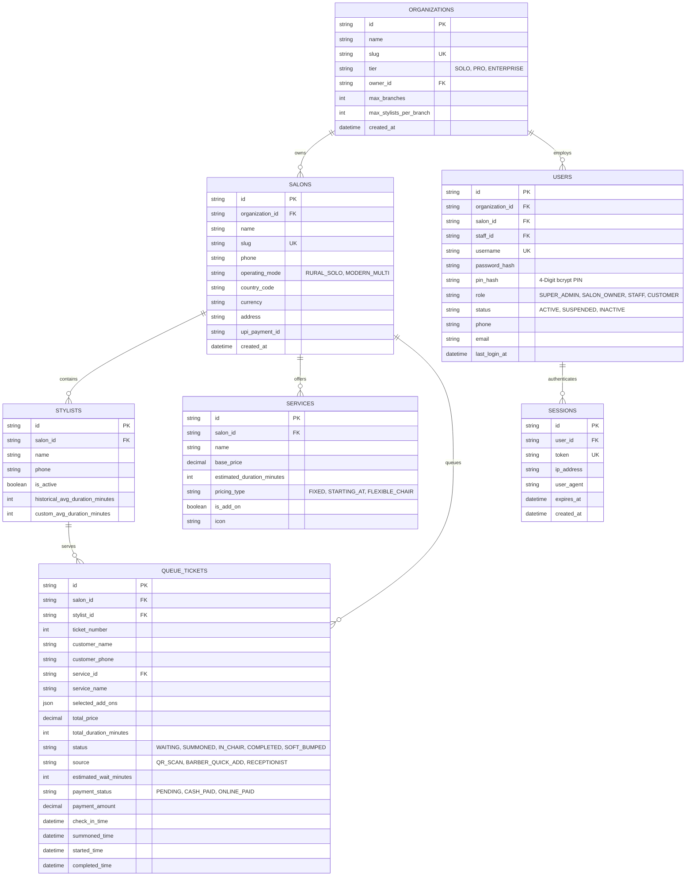
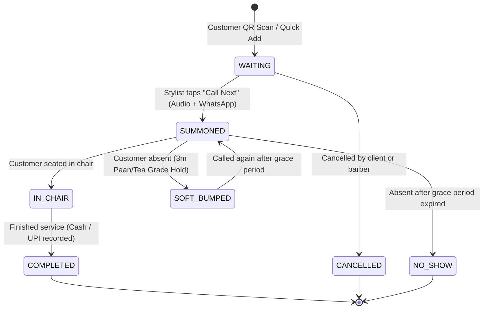

# System Architecture & Technical Specification
## Project: Engine Que System for Salons
**Document Version:** 2.0.0  
**Status:** Living Engineering Standard  

---

## 1. High-Level Architecture Overview

The Engine Que System employs a **Headless API-First Decoupled Architecture**. The system strictly separates high-frequency, real-time queue orchestration from complex administrative and presentation user interfaces.

```
┌────────────────────────────────────────────────────────────────────────┐
│                        PRESENTATION & CLIENT APPS                      │
├─────────────────┬──────────────────┬─────────────────┬─────────────────┤
│ Next.js 15 Web  │ Next.js 15 Web   │ Future Android  │ Lightweight     │
│ SuperAdmin Hub  │ Salon Owner Hub  │ App (Flutter)   │ Micro-Views     │
│ (/admin/*)      │ (/owner/*)       │ (Stylist/Owner) │ (Door QR & TV)  │
└────────┬────────┴────────┬─────────┴────────┬────────┴────────┬────────┘
         │                 │                  │                 │
         │  REST / JSON    │  REST / JSON     │ REST / JSON     │ REST + WS
         └────────┬────────┴────────┬─────────┴────────┬────────┘
                  ▼                 ▼                  ▼
┌────────────────────────────────────────────────────────────────────────┐
│             CORE HEADLESS BACKEND ENGINE (Bun v1.4.3 + ElysiaJS)       │
├────────────────────────────────────────────────────────────────────────┤
│ • Queue State Machine (Waiting -> Summoned -> In Chair -> Completed)   │
│ • Real-time WebSocket Broadcast Hub (/ws)                              │
│ • Stateful Zero-Trust Session & 4-Digit Quick PIN Engine               │
│ • Speed Calibration Engine & Dynamic Wait Time Calculator              │
│ • Subscription Tier Quota Enforcement (SOLO, PRO, ENTERPRISE)          │
│ • Automated WhatsApp Dispatcher (Mock & Meta Cloud API)                │
└───────────────────────────────────┬────────────────────────────────────┘
                                    ▼
┌────────────────────────────────────────────────────────────────────────┐
│                    PERSISTENCE: MySQL 8.0 / 9.1                        │
│ (organizations, users, sessions, salons, stylists, services, tickets)  │
└────────────────────────────────────────────────────────────────────────┘
```

---

## 2. Technology Stack & Decision Rationale

### A. Backend Core Engine: Bun v1.4.3 + ElysiaJS
* **Why Bun?**
  * **Native Sub-30ms Startup & Zero Transpile Lag:** Bun executes TypeScript natively without Webpack or Babel overhead.
  * **Ultra-Fast Bcrypt Hashing:** Bun provides native `Bun.password.hash()` and `Bun.password.verify()` written in C/Zig, running up to 3x faster than Node.js `bcryptjs`.
  * **High Concurrency WebSockets:** Bun’s native WebSocket implementation handles 100,000+ idle and active connections with minimal memory footprint ($<15\text{MB}$ for 10,000 sockets).
* **Why ElysiaJS?**
  * **TypeBox Compile-Time & Runtime Validation:** Schema validation executes directly against TypeBox, providing strict request body validation with zero overhead.
  * **Native Swagger/OpenAPI:** Endpoints are automatically documented and testable at `/swagger`.

### B. Persistence Layer: MySQL 8.0 / 9.1
* **Why MySQL?**
  * **ACID Transactions:** Ensures ticket numbers (#101, #102) increment monotonically without duplicates, even during rapid concurrent scans.
  * **Zero-Downtime Additive Schema Migrations:** Tables are structured with safe additive migrations (`ADD COLUMN IF NOT EXISTS`), ensuring schema updates never lock active queue tables.
  * **In-Memory Fallback:** The repository automatically maintains an in-memory cache, enabling instant offline operation or zero-dependency unit testing.

### C. Frontend Dashboard Layer: Next.js 15 (App Router) + Tailwind CSS + shadcn/ui
* **Why Next.js 15?**
  * **Ecosystem Velocity:** Replaces 1000s of lines of raw DOM manipulation with modular React Server Components (RSC) and Client Components.
  * **Ready-Made Data Tables & Charts:** Integrates `TanStack Table` for multi-branch salon sorting, search, filtering, and `Recharts` for revenue graphs.
  * **Bulletproof Forms:** Powered by `react-hook-form` + `zod` for input validation.

---

## 3. Database Schema & Entity-Relationship Model



---

## 4. Authentication & Stateful Session Security Matrix

```
┌─────────────────┬────────────────────┬──────────────────┬──────────────┐
│ Role            │ Primary Identity   │ Rapid Mirror PIN │ Kill Switch  │
├─────────────────┼────────────────────┼──────────────────┼──────────────┤
│ SUPER_ADMIN     │ Username / Email   │ N/A              │ Global       │
│ SALON_OWNER     │ Phone / Email / User│ N/A             │ Org Scope    │
│ STAFF (Stylist) │ Phone / Username   │ 4-Digit Keypad   │ 1-Tap Instant│
│ CUSTOMER        │ Phone (Optional)   │ None (Guest-1st) │ Auto-Expire  │
└─────────────────┴────────────────────┴──────────────────┴──────────────┘
```

### A. Multi-Identifier Login (`POST /api/auth/login`)
Accepts `identifier` (matching `username` OR `phone` OR `email`) and `password`. Returns a high-entropy 256-bit token stored in:
1. `sessions` table in MySQL (with 30-day expiration).
2. Memory cache in the runtime for zero-IO lookup.
3. HTTP-only secure cookie `engine_session` (and Bearer token header).

### B. Rapid 4-Digit PIN Switcher (`POST /api/auth/pin-switch`)
* Designed specifically for stylists sharing a single tablet on a mirror.
* Accepts `{ salonId, staffId, pin }`.
* Validates `pin` using `Bun.password.verify(pin, user.pinHash)`.
* Issues a fresh session in $<200\text{ms}$, switching the active chair without logging out or reloading.

### C. Owner Emergency Kill-Switch (`POST /api/auth/staff/revoke-all`)
* Allows salon owners to instantly revoke all active sessions for any staff member across all tablets, phones, and computers in one click.

---

## 5. Queue State Machine & Speed Calibration Engine



### Dynamic Wait-Time Calculation Formula
For any ticket $T$ entering the queue:
$$\text{WaitTime}(T) = \sum_{i=1}^{k} \text{Duration}(T_i) \times \text{StylistPaceFactor}(S)$$

Where:
* $\text{Duration}(T_i)$ is the service base duration plus any selected add-ons.
* $\text{StylistPaceFactor}(S) = \frac{\text{customAvgDurationMinutes}}{\text{historicalAvgDurationMinutes}}$.
* When a stylist slides their speed calibration from 30m to 20m, the queue engine recalculates all downstream wait times and broadcasts updates over WebSockets in real time.

---

## 6. Real-time WebSocket Protocol Specification (`/ws`)

Clients connect via `ws://<host>/ws?salonId=<salonId>`.

### Client-to-Server Messages
```json
{
  "action": "subscribe",
  "salonId": "salon-modern-01"
}
```

### Server-to-Client Mutation Broadcasts
Every state transition broadcasts an atomic event to all connected screens in that salon:

| Event Type | Trigger | Payload Summary |
|---|---|---|
| `TICKET_CREATED` | Customer checks in | `{ ticketNumber, customerName, waitMinutes }` |
| `TICKET_SUMMONED`| Stylist calls next | `{ ticketNumber, customerName, stylistName }` |
| `TICKET_SEATED`  | Client takes chair | `{ ticketNumber, stylistId }` |
| `TICKET_SOFT_BUMPED`| 3m grace hold | `{ ticketNumber, graceUntil }` |
| `TICKET_COMPLETED`| Service finished | `{ ticketNumber, totalPaid }` |

---

## 7. Future Hybrid Appointment + Walk-in Interleaving Algorithm

```mermaid
gantt
    title Stylist Chair 1 Timeline (Hybrid Walk-in + Booked Slots)
    dateFormat  HH:mm
    axisFormat  %H:%M
    section Chair 1
    Walk-in #101 (Haircut)    :done, 14:00, 14:25
    Walk-in #102 (Beard Trim) :active, 14:25, 14:45
    Buffer Window             :milestone, 14:45, 15:00
    Booked Appointment (VIP)  :crit, 15:00, 15:45
    Walk-in #103 (Haircut)    :15:45, 16:15
```



### The "Dynamic Time-Buffer" Rule:
1. When an online appointment is booked for 3:00 PM, a **Reserved Time Window** is placed on that stylist's calendar.
2. If a walk-in arrives at 2:20 PM requesting a 40-minute deluxe service, the engine computes:
   $$2:20\text{ PM} + 40\text{ mins} = 3:00\text{ PM (Conflict)}$$
3. The engine automatically reroutes the walk-in to an available stylist or notifies the walk-in: *"Estimated wait is 50 mins (next slot opens at 3:45 PM)"*.
