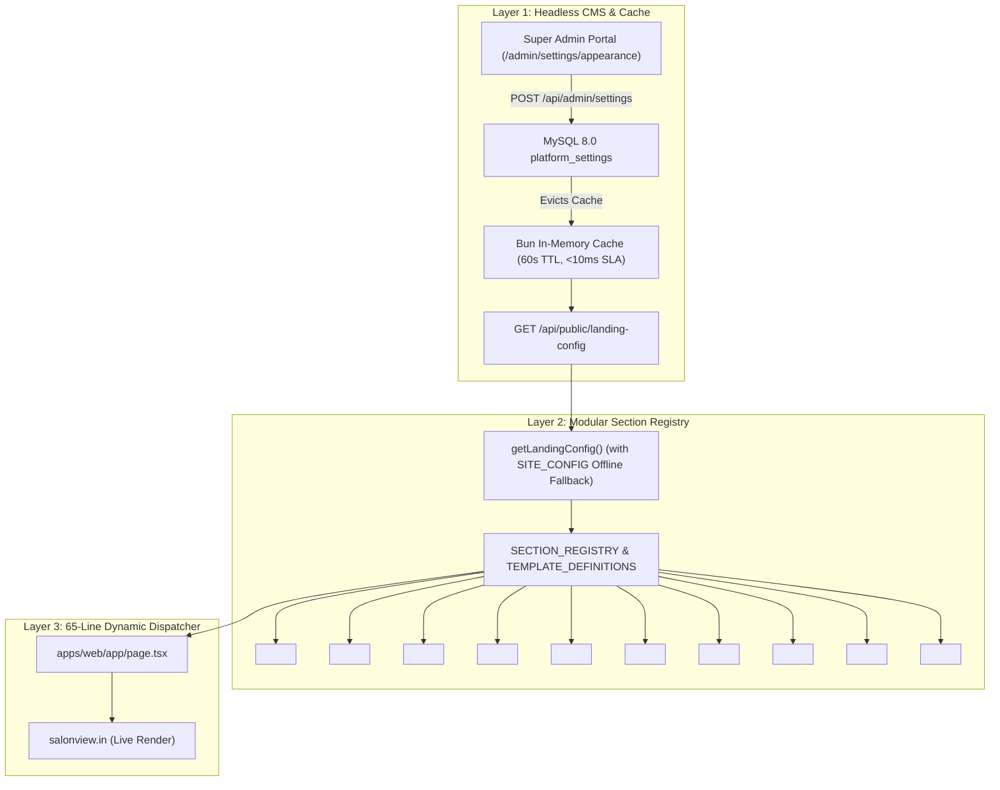

# Landing Page Modular Engine & Headless CMS: Master Specification

> **Scope Notice:** This document is strictly isolated to the **Public Landing Page System**, its Section Registry, switchable design templates, and Admin Headless CMS. General platform backend logic (appointments, escrow ledgers, queue worker daemons) is intentionally excluded to keep this specification concise and focused.

---

## 1. System Vision & The Modularization Mandate

Traditional SaaS landing pages frequently suffer from **monolithic duplication**: whenever a team tests a new visual concept (e.g. 2.5D Isometric Scrollytelling vs. Dark Obsidian Bento Grid vs. Minimalist Typography), developers build duplicate 1,500-line `page-v2.tsx` or `page-dark.tsx` files. This duplicates interactive widgets (queue simulators, ROI calculators, pricing tables), creating massive maintenance debt and broken links.

The **SalonView Landing Engine** solves this with a **3-Layer Modular Architecture**:



---

## 2. The 3 Switchable Templates

The Super Admin can toggle between templates in $<1\text{ second}$ directly from `/admin/settings/appearance`:

| Template Key | Visual Identity | Hero Component | Default Sections | Target Audience & Tone |
| :--- | :--- | :--- | :--- | :--- |
| `2_5D_SCROLL` | **Isometric 2.5D Scrollytelling** | `<Hero2Point5D>` | Simulator, TV Mirror, UPI, ROI, Pricing, Partners, FAQ | High-visual impact for modern salon owners who want to experience the 3D customer journey without heavy WebGL bundles. |
| `BENTO_OBSIDIAN` | **Dark Obsidian Bento Grid** | `<HeroBento>` | Simulator, ROI, TV Mirror, UPI, Pricing, Partners, FAQ | High-tech Linear/Vercel styling with glowing emerald borders and active telemetry status ribbons for urban boutique chains. |
| `MINIMALIST_LUXE` | **Minimalist Luxe** | `<HeroMinimalist>` | Simulator, Pricing, ROI, Partners, FAQ | Typography-first, sub-second load times, ultra-clean editorial layout prioritizing instant conversion. |

---

## 3. Atomic Section Registry (`apps/web/components/landing/*`)

All landing pages are composed from isolated, typed components:

1. **[`navbar.tsx`](file:///v:/salon/queue-engine-for-salon/apps/web/components/landing/navbar.tsx):**
   - Brand logo, live telemetry pulse, nav anchor links, and partner program pill (`config.partnerCommissionPct%`).
2. **[`footer.tsx`](file:///v:/salon/queue-engine-for-salon/apps/web/components/landing/footer.tsx):**
   - Dynamic brand name, legal tagline, portal links, and WebSocket status indicator.
3. **[`hero-2point5d.tsx`](file:///v:/salon/queue-engine-for-salon/apps/web/components/landing/hero-2point5d.tsx):**
   - Hardware-accelerated CSS 3D perspective (`perspective: 1200px`, `transform-style: preserve-3d`).
   - Floating pocket ticket `#104`, WhatsApp alert card, and chair desk preview.
   - Mobile responsive: falls back to 2D on mobile screens ($\le 640\text{px}$) to avoid horizontal overflow.
4. **[`hero-bento.tsx`](file:///v:/salon/queue-engine-for-salon/apps/web/components/landing/hero-bento.tsx):**
   - High-contrast 4-card bento grid with emerald border micro-glows.
5. **[`hero-minimalist.tsx`](file:///v:/salon/queue-engine-for-salon/apps/web/components/landing/hero-minimalist.tsx):**
   - Clean editorial typography with direct checkmark proof points.
6. **[`queue-simulator.tsx`](file:///v:/salon/queue-engine-for-salon/apps/web/components/landing/queue-simulator.tsx):**
   - Clickable "Call Next Customer" sandbox triggering simulated ticket increments and WhatsApp dispatch popover.
7. **[`tv-mirror-preview.tsx`](file:///v:/salon/queue-engine-for-salon/apps/web/components/landing/tv-mirror-preview.tsx):**
   - Waiting lounge departure board TV showcase with customer phone masking protocol.
8. **[`upi-showcase.tsx`](file:///v:/salon/queue-engine-for-salon/apps/web/components/landing/upi-showcase.tsx):**
   - Client-side dynamic NPCI UPI QR code generation preview with 0% gateway fee badge.
9. **[`roi-calculator.tsx`](file:///v:/salon/queue-engine-for-salon/apps/web/components/landing/roi-calculator.tsx):**
   - Interactive sliders (chairs, weekend walk-outs, avg ticket) computing monthly lost cash and platform ROI multiplier.
10. **[`pricing-section.tsx`](file:///v:/salon/queue-engine-for-salon/apps/web/components/landing/pricing-section.tsx):**
    - Dynamic Starter, Pro, and Elite subscription cards reading live rates from CMS config.
11. **[`partner-banner.tsx`](file:///v:/salon/queue-engine-for-salon/apps/web/components/landing/partner-banner.tsx):**
    - Pre-footer affiliate recruitment banner routing to `/partners`.
12. **[`faq-accordion.tsx`](file:///v:/salon/queue-engine-for-salon/apps/web/components/landing/faq-accordion.tsx):**
    - Accessible collapsible FAQ addressing salon owner objections (wet hands, non-smartphone clients, etc.).

---

## 4. The 65-Line Dynamic Dispatcher (`apps/web/app/page.tsx`)

The root page is strictly an orchestrator:

```tsx
import React from "react";
import { getLandingConfig } from "@/lib/landing-config";
import { LandingNavbar } from "@/components/landing/navbar";
import { LandingFooter } from "@/components/landing/footer";
import { TEMPLATE_DEFINITIONS, SECTION_REGISTRY, type TemplateId } from "@/components/landing/registry";

export default async function MarketingHomePage() {
  const config = await getLandingConfig();
  const templateKey = config.activeTemplate as TemplateId;
  const template = TEMPLATE_DEFINITIONS[templateKey] || TEMPLATE_DEFINITIONS["2_5D_SCROLL"];
  const HeroComponent = template.heroComponent;

  const enabledSections = new Set<string>(
    config.enabledSections && config.enabledSections.length > 0
      ? config.enabledSections
      : template.defaultSections
  );

  return (
    <div className="min-h-screen bg-slate-950 text-slate-100 flex flex-col justify-between">
      <LandingNavbar config={config} />
      <main className="flex-1">
        <HeroComponent config={config} />
        {enabledSections.has("simulator") && <SECTION_REGISTRY.simulator config={config} />}
        {enabledSections.has("tv_mirror") && <SECTION_REGISTRY.tv_mirror config={config} />}
        {enabledSections.has("upi_showcase") && <SECTION_REGISTRY.upi_showcase config={config} />}
        {enabledSections.has("roi_calculator") && <SECTION_REGISTRY.roi_calculator config={config} />}
        {enabledSections.has("pricing") && <SECTION_REGISTRY.pricing config={config} />}
        {enabledSections.has("partner_banner") && <SECTION_REGISTRY.partner_banner config={config} />}
        {enabledSections.has("faq") && <SECTION_REGISTRY.faq config={config} />}
      </main>
      <LandingFooter config={config} />
    </div>
  );
}
```

---

## 5. How to Add a New Landing Page Design (in $<15$ Lines of Code)

To create a new template (e.g. `FESTIVE_DIWALI` or `MINIMALIST_LIGHT`):

1. **Create the Hero (or use an existing one):**
   ```tsx
   // apps/web/components/landing/hero-festive.tsx
   export const HeroFestive: React.FC<SectionProps> = ({ config }) => { ... };
   ```
2. **Register it in [`registry.ts`](file:///v:/salon/queue-engine-for-salon/apps/web/components/landing/registry.ts):**
   ```typescript
   export const TEMPLATE_DEFINITIONS: Record<TemplateId, TemplateDefinition> = {
     // ... existing templates ...
     "FESTIVE_PROMO": {
       id: "FESTIVE_PROMO",
       name: "Festive Promo Edition",
       description: "High-energy gold & amber theme for holiday salon rushes.",
       heroComponent: HeroFestive,
       defaultSections: ["simulator", "pricing", "roi_calculator", "faq"],
     },
   };
   ```
3. **Done!** The Super Admin immediately sees the new template card in `/admin/settings/appearance` and can activate it with 1 click. Zero duplicate page files created.

---

## 6. Safety, Fallbacks & Rollback Verification

1. **Git Rollback Point:**
   - Tag: `rollback-base-landing-engine`
   - Branch: `backup/pre-landing-overhaul`
   - Command to roll back if ever needed: `git checkout backup/pre-landing-overhaul`
2. **Runtime Offline Resilience:**
   - If the backend or database is offline, `getLandingConfig()` in [`apps/web/lib/landing-config.ts`](file:///v:/salon/queue-engine-for-salon/apps/web/lib/landing-config.ts) catches network exceptions and returns default `SITE_CONFIG` values without crashing or throwing a 500 error.
3. **Template Key Corruption Fallback:**
   - If an invalid template key is passed, the dispatcher defaults to `2_5D_SCROLL` automatically.
