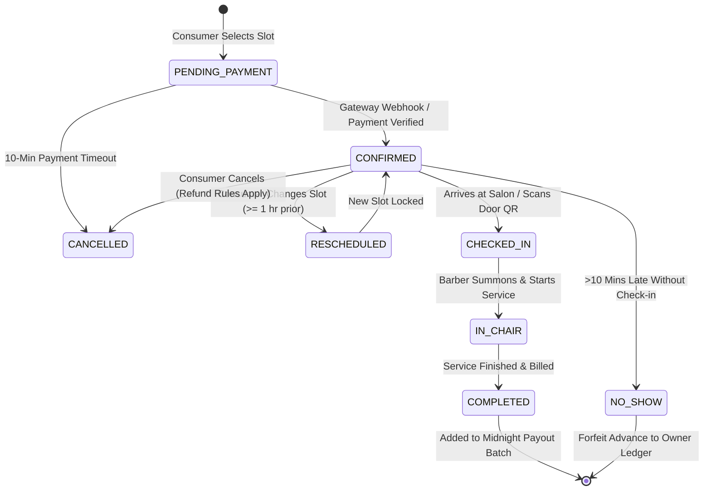
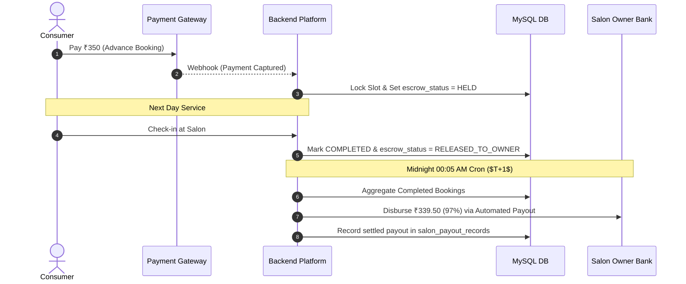
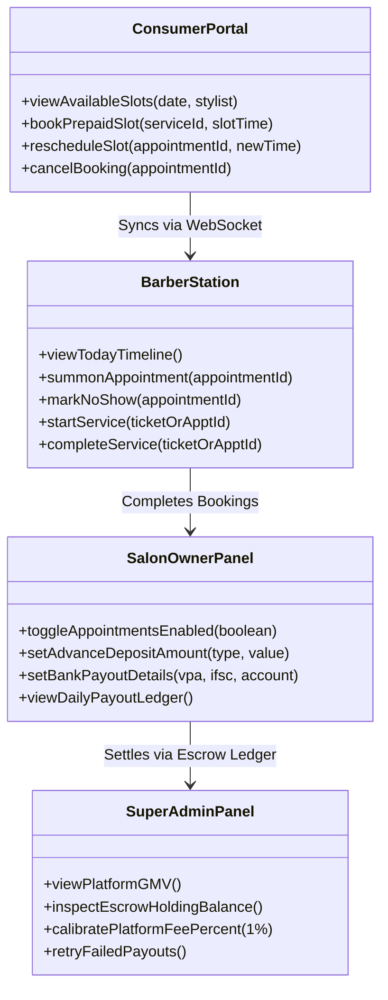

# System Architecture: Hybrid Appointment & Queue Engine

## 1. High-Level Architectural Topology

```mermaid
flowchart TB
    subgraph Clients["Edge Clients (Client-Compute PWA)"]
        CB[Consumer Booking Portal<br/><code>/s/[slug]/book</code>]
        WQ[Walk-in Queue Portal<br/><code>/s/[slug]/queue</code>]
        BS[Barber Station Dashboard<br/><code>/owner/station</code>]
        TV[Lobby Mirror TV<br/><code>/s/[slug]/tv</code>]
        SA[Super Admin Hub<br/><code>/admin/payouts</code>]
    end

    subgraph GatewayLayer["API & Ingestion Layer (Bun + Elysia)"]
        HTTP[REST Endpoints<br/><code>/api/v1/appointments/*</code>]
        WSHub[WebSocket Hub<br/>Real-Time State Broadcast]
        GZipZstd[Adaptive Compression<br/>Zstd / Brotli / Gzip]
    end

    subgraph CoreEngines["Core Domain Engines"]
        QEngine[Queue & Buffer Interleaver<br/>Dynamic Timeline Math]
        EscrowEng[Escrow & Payout Engine<br/>Split 97% Owner / 3% Platform]
        ReschedEng[Self-Service Reschedule Engine<br/>Atomic Slot Swap]
    end

    subgraph DataStore["State Authority (MySQL 8.0 InnoDB)"]
        T_Appt[(appointments)]
        T_Queue[(queue_tickets)]
        T_Payout[(salon_payout_records)]
        T_Wallet[(wallets & ledger)]
    end

    CB -->|Prepaid Booking / Reschedule| HTTP
    WQ -->|Walk-in Check-in| HTTP
    BS -->|Summon / No-Show / Complete| HTTP
    SA -->|Payout Release / Audit| HTTP

    HTTP --> GZipZstd
    HTTP --> CoreEngines
    CoreEngines --> DataStore
    CoreEngines -->|State Mutation Event| WSHub
    WSHub -->|Push Updates| BS
    WSHub -->|Push Updates| TV
    WSHub -->|Push Updates| WQ
    WSHub -->|Push Updates| CB
```

---

## 2. Appointment Lifecycle State Machine



---

## 3. Escrow & Split Financial Architecture

### 3.1 Financial Flow Breakdown
1. **Consumer Checkout:** Customer pays ₹350 advance into platform merchant account (Razorpay / Cashfree / Platform UPI).
2. **Escrow Holding:** Funds are tagged as `escrow_status: 'HELD'` associated with `appointment_id`.
3. **Completion Trigger:** When barber marks `COMPLETED`, the transaction moves to `escrow_status: 'RELEASED_TO_OWNER'`.
4. **Daily Clearing Window ($T+1$ at Midnight):**
   - The platform calculates:
     $$\text{Owner Payout} = \text{Gross} \times 0.97$$
     $$\text{Platform Margin} = \text{Gross} \times 0.01$$
     $$\text{Payment Gateway Cost} = \text{Gross} \times 0.02$$
   - Generates payout batch record and sends UPI transfer to the salon owner's registered VPA or bank account.



---

## 4. Multi-Tenant Role Isolation & Touchpoints


