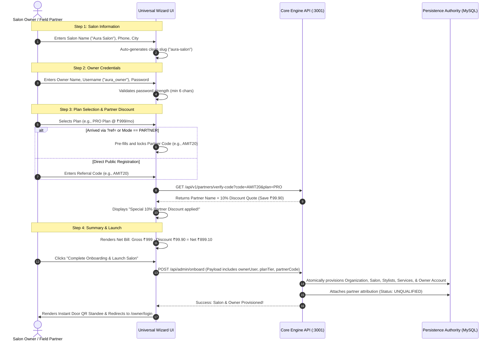
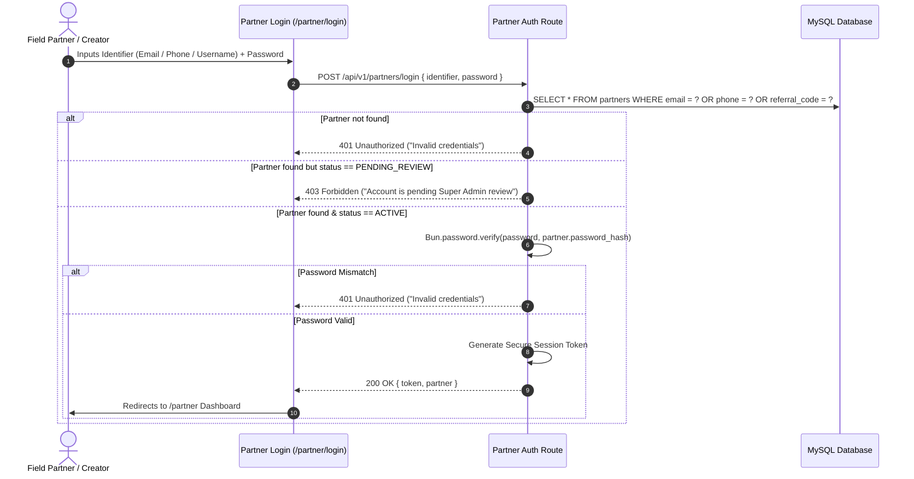
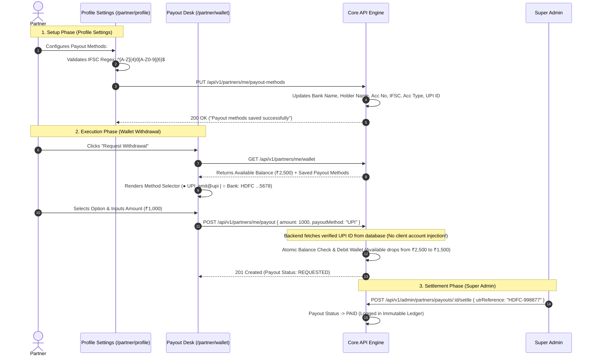

# Complete Application Flow & Architecture Blueprint (v2.0)
## Universal Onboarding & Partner Platform

| Document Type | Target | Status |
| :--- | :--- | :--- |
| **App Flow & Sequence Architecture** | Web (`apps/web`), API (`apps/api`) | Complete & Verified |

---

## 1. URL Architecture & Namespace Segregation

1. **Salon Business Portal (Owners & Stylists):**
   - Moved to a dedicated **`/salon/login`** (and accessible via **`/owner/login`** and **`/staff/login`**).
   - Dedicated exclusively to salon operations, chair management, appointments, and billing.

2. **Affiliate & Promoter Network (100% Reserved at `/partner`):**
   - The entire **`/partner/*`** namespace is reclaimed exclusively for Field Partners, Online Creators, and Growth Affiliates:
     - `/partner/join` ──► Public application form
     - `/partner/login` ──► Enterprise multi-identifier partner login (Email/Phone/Username + Password)
     - `/partner` ──► Executive partner dashboard & wallet
     - `/partner/onboard` ──► Universal Onboarding Wizard in `PARTNER` mode
     - `/partner/salons` ──► Referred salons directory & live ticket milestones
     - `/partner/wallet` ──► Double-entry earnings ledger & instant 1-tap withdrawal
     - `/partner/marketing` ──► Pitch decks, scripts, and printable QR standees
     - `/partner/profile` ──► 360° profile & saved payout methods (UPI + full Bank details)

---

## 2. Universal Onboarding Sequence (`<UniversalSalonOnboardingWizard />`)



---

## 3. Enterprise Multi-Identifier Partner Login Flow



---

## 4. Separation of Payout Profiles vs Withdrawal Execution Flow



---

## 5. Screen Navigation & Component Hierarchy Map

```
apps/web/
├── app/
│   ├── (Public Self-Serve)
│   │   ├── /register ───────────────► Universal Onboarding Wizard (mode="PUBLIC")
│   │   ├── /login ──────────────────► Customer Login
│   │   └── /salon/login ────────────► Dedicated Salon Business Login (Owner & Stylists)
│   │
│   ├── partner/ (Affiliate & Growth Panel)
│   │   ├── layout.tsx ──────────────► Enterprise Panel Shell (Sidebar, Topbar, Wallet Pill)
│   │   ├── page.tsx ────────────────► Executive Dashboard (KPIs, Referral Link, QR Card)
│   │   ├── join/page.tsx ───────────► Public Partner Application with Password Setup
│   │   ├── login/page.tsx ──────────► Enterprise Multi-Identifier Login (AuthCardLayout)
│   │   ├── onboard/page.tsx ────────► Universal Onboarding Wizard (mode="PARTNER")
│   │   ├── salons/page.tsx ─────────► Referred Salons Directory & Ticket Milestones
│   │   ├── wallet/page.tsx ─────────► Real-time Ledger & 1-Tap Option-Based Withdrawal
│   │   ├── marketing/page.tsx ──────► Pitch Decks, 60s Script & Printable Counter Standees
│   │   └── profile/page.tsx ────────► Profile & Saved Payout Methods (UPI + Full Bank)
│   │
│   └── admin/ (Super Admin Governance)
│       ├── onboarding/page.tsx ─────► Universal Onboarding Wizard (mode="ADMIN")
│       └── partners/ ───────────────► Partner Directory, Contract Editor, & Payout Desk
│
└── components/
    └── onboarding/
        ├── universal-onboarding-wizard.tsx ──► The Core 4-Step Universal Engine
        ├── step-salon-info.tsx ──────────────► Step 1: Salon Identity & Location
        ├── step-owner-account.tsx ───────────► Step 2: Owner User Credentials
        ├── step-plan-selection.tsx ──────────► Step 3: Plans + Live Partner Discount
        └── step-launch-summary.tsx ──────────► Step 4: Net Bill & Instant Activation
```
