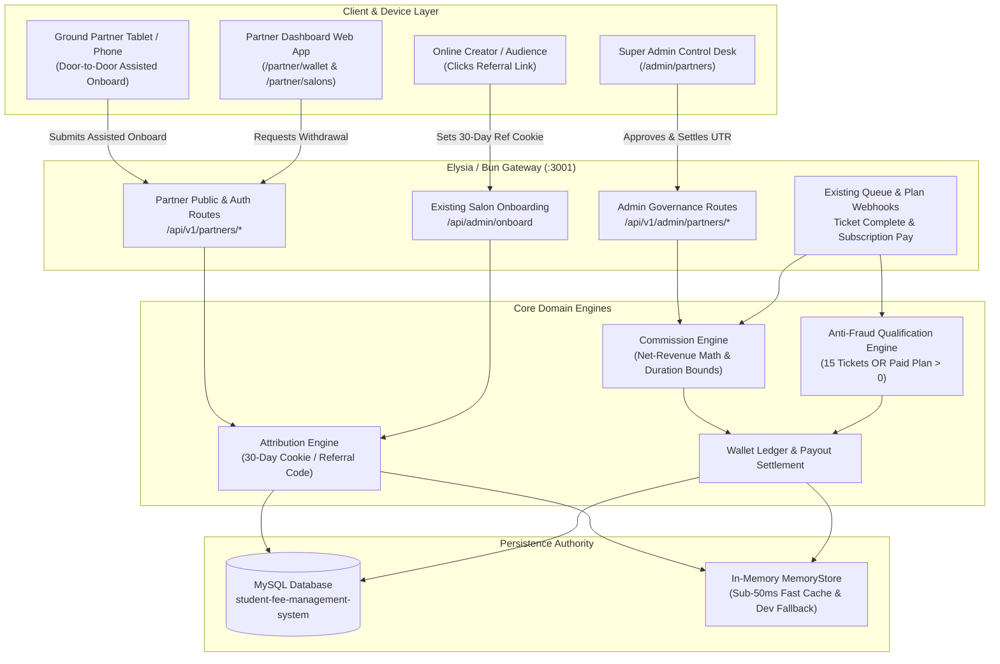

# System Architecture & Technical Specifications
## Host & Field Partner Affiliate Platform

| Module | Location | Runtime / DB |
| :--- | :--- | :--- |
| **Backend API** | `apps/api/src/routes/partner.routes.ts`, `apps/api/src/routes/admin.partner.routes.ts` | Bun + ElysiaJS |
| **Data Layer** | `apps/api/src/db/repositories/partner.repo.ts`, `apps/api/src/db/schema.sql` | MySQL 8.0 + In-Memory Fallback |
| **Frontend Portal** | `apps/web/app/partner/*`, `apps/web/app/admin/partners/*` | Next.js 16 (App Router) + React 19 |

---

## 1. System Topology & Data Flow



---

## 2. Database Schema Specification (`apps/api/src/db/schema.sql`)

### 2.1 Table: `partners`
Stores registered partner identities, personas, commission configurations, and bank/UPI details.

```sql
CREATE TABLE IF NOT EXISTS partners (
  id VARCHAR(64) PRIMARY KEY,
  user_id VARCHAR(64) NULL,
  full_name VARCHAR(128) NOT NULL,
  phone VARCHAR(20) NOT NULL UNIQUE,
  email VARCHAR(128) NULL,
  city VARCHAR(64) NOT NULL,
  persona ENUM('CREATOR', 'GROUND_HUSTLER', 'SALON_OWNER', 'DEDICATED') NOT NULL DEFAULT 'GROUND_HUSTLER',
  referral_code VARCHAR(32) NOT NULL UNIQUE,
  status ENUM('PENDING_REVIEW', 'ACTIVE', 'PAUSED', 'REJECTED') NOT NULL DEFAULT 'PENDING_REVIEW',
  commission_model ENUM('RECURRING_PERCENT', 'FLAT_BOUNTY', 'HYBRID') NOT NULL DEFAULT 'RECURRING_PERCENT',
  commission_percent DECIMAL(5,2) NOT NULL DEFAULT 10.00,
  bounty_amount DECIMAL(10,2) NOT NULL DEFAULT 0.00,
  duration_type ENUM('LIFETIME', '3_MONTHS', '6_MONTHS', '12_MONTHS') NOT NULL DEFAULT '6_MONTHS',
  duration_end_date DATETIME NULL,
  is_commission_paused BOOLEAN NOT NULL DEFAULT FALSE,
  payout_upi_id VARCHAR(128) NULL,
  payout_bank_account VARCHAR(64) NULL,
  payout_bank_ifsc VARCHAR(32) NULL,
  pitch_notes TEXT NULL,
  created_at DATETIME NOT NULL DEFAULT CURRENT_TIMESTAMP,
  updated_at DATETIME NOT NULL DEFAULT CURRENT_TIMESTAMP ON UPDATE CURRENT_TIMESTAMP,
  INDEX idx_partner_referral_code (referral_code),
  INDEX idx_partner_status (status),
  INDEX idx_partner_phone (phone)
);
```

### 2.2 Table: `partner_salon_attributions`
Links a salon to the partner who onboarded it, tracking qualification progress and duration limits.

```sql
CREATE TABLE IF NOT EXISTS partner_salon_attributions (
  id VARCHAR(64) PRIMARY KEY,
  partner_id VARCHAR(64) NOT NULL,
  salon_id VARCHAR(64) NOT NULL UNIQUE,
  source ENUM('LINK', 'PROMO_CODE', 'ASSISTED_ONBOARDING', 'ADMIN_ASSIGNED') NOT NULL DEFAULT 'LINK',
  qualification_status ENUM('UNQUALIFIED', 'QUALIFIED') NOT NULL DEFAULT 'UNQUALIFIED',
  tickets_completed_count INT NOT NULL DEFAULT 0,
  first_paid_plan_at DATETIME NULL,
  commission_expires_at DATETIME NULL,
  created_at DATETIME NOT NULL DEFAULT CURRENT_TIMESTAMP,
  FOREIGN KEY (partner_id) REFERENCES partners(id) ON DELETE CASCADE,
  INDEX idx_attribution_partner (partner_id),
  INDEX idx_attribution_salon (salon_id),
  INDEX idx_attribution_qual (qualification_status)
);
```

### 2.3 Table: `partner_wallet_ledger`
Double-entry immutable audit ledger for every credit and debit transaction.

```sql
CREATE TABLE IF NOT EXISTS partner_wallet_ledger (
  id VARCHAR(64) PRIMARY KEY,
  partner_id VARCHAR(64) NOT NULL,
  salon_id VARCHAR(64) NULL,
  transaction_type ENUM('COMMISSION_CREDIT', 'BOUNTY_CREDIT', 'WITHDRAWAL_DEBIT', 'ADJUSTMENT') NOT NULL,
  gross_plan_amount DECIMAL(10,2) NOT NULL DEFAULT 0.00,
  discount_amount DECIMAL(10,2) NOT NULL DEFAULT 0.00,
  net_paid_amount DECIMAL(10,2) NOT NULL DEFAULT 0.00,
  commission_amount DECIMAL(10,2) NOT NULL,
  balance_type ENUM('PENDING_LOCK', 'AVAILABLE') NOT NULL DEFAULT 'PENDING_LOCK',
  description VARCHAR(255) NOT NULL,
  reference_id VARCHAR(128) NULL,
  created_at DATETIME NOT NULL DEFAULT CURRENT_TIMESTAMP,
  FOREIGN KEY (partner_id) REFERENCES partners(id) ON DELETE CASCADE,
  INDEX idx_ledger_partner_balance (partner_id, balance_type)
);
```

### 2.4 Table: `partner_payout_requests`
Tracks withdrawal requests from the partner wallet through admin approval and bank UTR settlement.

```sql
CREATE TABLE IF NOT EXISTS partner_payout_requests (
  id VARCHAR(64) PRIMARY KEY,
  partner_id VARCHAR(64) NOT NULL,
  amount DECIMAL(10,2) NOT NULL,
  payout_method ENUM('UPI', 'BANK_TRANSFER') NOT NULL DEFAULT 'UPI',
  payout_target VARCHAR(128) NOT NULL,
  status ENUM('REQUESTED', 'APPROVED', 'PAID', 'REJECTED') NOT NULL DEFAULT 'REQUESTED',
  utr_reference VARCHAR(128) NULL,
  admin_notes TEXT NULL,
  requested_at DATETIME NOT NULL DEFAULT CURRENT_TIMESTAMP,
  settled_at DATETIME NULL,
  FOREIGN KEY (partner_id) REFERENCES partners(id) ON DELETE CASCADE,
  INDEX idx_payout_partner (partner_id),
  INDEX idx_payout_status (status)
);
```

### 2.5 Table: `partner_notifications`
In-app notification system for partner events.

```sql
CREATE TABLE IF NOT EXISTS partner_notifications (
  id VARCHAR(64) PRIMARY KEY,
  partner_id VARCHAR(64) NOT NULL,
  title VARCHAR(128) NOT NULL,
  message TEXT NOT NULL,
  type ENUM('SALON_JOINED', 'EARNING_CREDITED', 'QUALIFIED', 'PAYOUT_STATUS', 'SYSTEM') NOT NULL,
  is_read BOOLEAN NOT NULL DEFAULT FALSE,
  created_at DATETIME NOT NULL DEFAULT CURRENT_TIMESTAMP,
  FOREIGN KEY (partner_id) REFERENCES partners(id) ON DELETE CASCADE,
  INDEX idx_notif_partner (partner_id, is_read)
);
```

---

## 3. State Machines & Business Logic Transitions

### 3.1 Partner Lifecycle State Machine
```
   [ Application Submitted ]
              │
              ▼
       PENDING_REVIEW ──(Admin Reject)──► REJECTED
              │
        (Admin Approve)
              │
              ▼
            ACTIVE ◄────(Admin Resume)─────┐
              │                            │
         (Admin Pause)                     │
              │                            │
              ▼                            │
            PAUSED ────────────────────────┘
```

### 3.2 Attribution Qualification State Machine
```
   [ Salon Onboarded via Partner ]
                  │
                  ▼
         UNQUALIFIED (Earnings Locked in PENDING_LOCK)
                  │
      ┌───────────┴───────────┐
      ▼                       ▼
  Completed >= 15 Tickets   Purchased Paid Plan (Net Paid > 0)
      └───────────┬───────────┘
                  ▼
             QUALIFIED ──► Releases PENDING_LOCK -> AVAILABLE Balance
```

---

## 4. REST API Endpoint Contracts

### 4.1 Partner Domain (`apps/api/src/routes/partner.routes.ts`)

#### `POST /api/v1/partners/apply`
Public submission endpoint for creators and ground hustlers.
- **Request:**
  ```json
  {
    "fullName": "Amit Verma",
    "phone": "9876543210",
    "email": "amit@example.com",
    "city": "Bareilly",
    "persona": "GROUND_HUSTLER",
    "pitchNotes": "Door to door salon visits in Civil Lines",
    "payoutUpiId": "amit@okaxis"
  }
  ```
- **Response (201):**
  ```json
  {
    "success": true,
    "partner": {
      "id": "part_1731330000_abcde",
      "referralCode": "AMITVERMA",
      "status": "PENDING_REVIEW",
      "message": "Application submitted. Super admin will review within 24 hours."
    }
  }
  ```

#### `POST /api/v1/partners/assisted-onboard`
Door-to-door wizard endpoint called from `/partner/onboard`.
- **Request:**
  ```json
  {
    "partnerId": "part_1731330000_abcde",
    "salonName": "Royal Men's Salon",
    "ownerName": "Ramesh Kumar",
    "ownerPhone": "9876500000",
    "city": "Bareilly",
    "verificationCode": "1234"
  }
  ```
- **Response (201):**
  ```json
  {
    "success": true,
    "salon": {
      "id": "salon_xyz",
      "name": "Royal Men's Salon",
      "slug": "royal-mens-salon"
    },
    "attribution": {
      "partnerId": "part_1731330000_abcde",
      "qualificationStatus": "UNQUALIFIED"
    }
  }
  ```

#### `GET /api/v1/partners/me/wallet`
Fetches balance and full transaction ledger.
- **Response (200):**
  ```json
  {
    "success": true,
    "wallet": {
      "availableBalance": 2450.00,
      "pendingLockedBalance": 500.00,
      "lifetimeEarnings": 3950.00,
      "totalWithdrawn": 1000.00
    },
    "recentTransactions": [
      {
        "id": "ledg_1",
        "salonName": "Royal Men's Salon",
        "transactionType": "COMMISSION_CREDIT",
        "grossPlanAmount": 1000.00,
        "discountAmount": 200.00,
        "netPaidAmount": 800.00,
        "commissionAmount": 80.00,
        "balanceType": "AVAILABLE",
        "createdAt": "2026-11-11T12:00:00Z"
      }
    ]
  }
  ```

#### `POST /api/v1/partners/me/payout`
Submits withdrawal request to UPI/Bank.
- **Request:**
  ```json
  {
    "amount": 1500.00,
    "payoutMethod": "UPI",
    "payoutTarget": "amit@okaxis"
  }
  ```

---

### 4.2 Super Admin Domain (`apps/api/src/routes/admin.partner.routes.ts`)

#### `PATCH /api/v1/admin/partners/:id/commission`
Modifies partner compensation parameters.
- **Request:**
  ```json
  {
    "commissionModel": "RECURRING_PERCENT",
    "commissionPercent": 15.00,
    "durationType": "6_MONTHS",
    "isCommissionPaused": false
  }
  ```

#### `POST /api/v1/admin/partners/payouts/:id/settle`
Marks withdrawal settled with banking reference.
- **Request:**
  ```json
  {
    "utrReference": "UPI-432198765432",
    "adminNotes": "Transferred via HDFC Current Account"
  }
  ```
