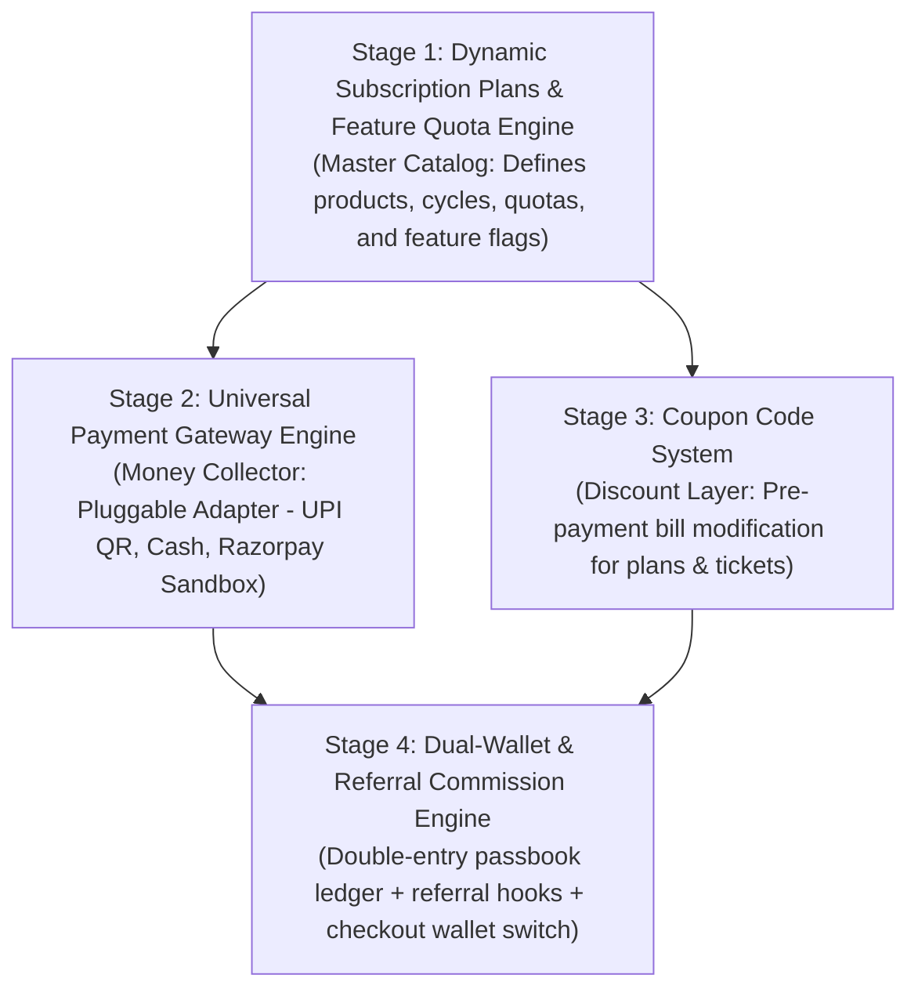

# Universal Clean SaaS Subscription, Dual-Wallet, & Pluggable Payment Architecture

## 1. Executive Summary & Architectural Memory

This document establishes the permanent architectural record and system memory for the Monetization, Retention, and Growth Engines of the `queue-engine-for-salon` platform. It unifies four mission-critical subsystems:

1. **Dynamic Subscription Plans & Feature Quota Engine** (Admin-controlled, zero hardcoding, multi-cycle duration calibrator, selective cycle toggles, and feature checklists).
2. **Universal Pluggable Payment Gateway Engine** (Adapter pattern: NPCI-compliant dynamic UPI QR, Cash counter settlement, Razorpay Sandbox, and future-ready payment gateways).
3. **Omni-Channel Coupon Code System** (Promotional campaigns for SaaS subscriptions and salon customer visits).
4. **Dual-Wallet & Referral Commission Engine** (Double-entry passbook ledger serving both B2B Salon Owners and B2C Salon Consumers).

---

## 2. Dependency Hierarchy & Execution Sequence



### Why this sequence guarantees zero blocked work:
- **Stage 1 (First):** You cannot purchase a subscription, apply a coupon, or discount with wallet credits if subscription plans do not exist dynamically in the database.
- **Stage 2 (Second):** Establishes the reusable gateway infrastructure to collect funds for subscriptions, services, or wallet top-ups.
- **Stage 3 (Third):** Sits directly between the plan price and the final payment settlement.
- **Stage 4 (Fourth):** Ties all pieces together: credits rewards upon referral conversion, and allows 1-tap checkout deduction ($\text{Net Payable} = \text{Base Price} - \text{Coupon} - \text{Wallet}$).

---

## 3. Subsystem Specifications

### 3.1 Subsystem 1: Dynamic Subscription Plans & Feature Quota Engine
- **Core Problem Solved:** Eliminates hardcoded `SubscriptionTier` enums (`STARTER`, `PRO`, `ENTERPRISE`) from code. SuperAdmin can create, edit, draft, and archive unlimited plans directly from the Admin Portal.
- **Multi-Cycle Anti-Clutter Design:** A single plan record natively stores pricing for 4 standard billing cycles (`1m`, `3m`, `6m`, `1y`) rather than polluting the database with multiple plan rows.
- **Selective Cycle Toggles:** Admin can choose which cycles are offered per plan (e.g. enable only 1M, or 1M + 3M).
- **Two-Way Smart Price / Discount Calibrator:**
  - Admin enters Base 1-Month Price (e.g. ₹500).
  - Admin can enter a discount percentage (e.g. 10% off for 3m $\rightarrow$ ₹1,350 auto-calculated), OR enter an exact custom amount (e.g. ₹1,299 $\rightarrow$ auto-computes 13.4% discount badge).
- **Comprehensive Feature & Quota Checklist:**
  - Branch limits (`max_branches`), Chair/Stylist limits (`max_stylists_per_branch`).
  - Feature toggles: Station Mirror Desk, TV Mirror Lounge Display, WhatsApp Engine, Shift Analytics, Custom Speed Calibration, Staff Leave Management, Loyalty Stamp Cards, Consumer Referrals, and Digital Storefront.

### 3.2 Subsystem 2: Universal Pluggable Payment Gateway Engine
- **Architectural Pattern:** Strategy / Adapter Pattern via `PaymentGatewayAdapter` interface.
- **Providers Implemented:**
  1. **Dynamic NPCI UPI QR Code:** Generates client-side HTML5 canvas QR with pre-filled salon/platform VPA and exact amount. Adheres to Rule 1 (Zero Server Waste & Client-Compute).
  2. **Cash / Manual Counter Settlement:** Instant 1-tap confirmation by the barber desk or admin with verification audit logs.
  3. **Razorpay Sandbox / Test Mode:** Pre-wired standard checkout modal using dummy test keys (`rzp_test_...`), ready to drop in production keys without code modification.
  4. **Future Extensibility:** Plug-and-play architecture for Cashfree, PhonePe, Stripe, and PayU.

### 3.3 Subsystem 3: Coupon Code System
- **Dual Target Applicability:**
  - `SUBSCRIPTION`: Admin-created coupons discounting SaaS plan purchases.
  - `SALON_SERVICE`: Salon owner-created coupons discounting haircut and grooming services for walk-in clients.
- **Discount Mechanics:** Supports Flat ₹ discounts and Percentage % discounts with minimum order thresholds, max redemptions, and expiration dates.

### 3.4 Subsystem 4: Dual-Wallet & Referral Commission Engine
- **Two User Groups, One Clean Engine:**
  - **B2B Salon Owners (`owner_wallets`):** Earn commissions for referring other salon owners to the platform. Credits can be used to pay or discount SaaS subscription renewals down to ₹0.
  - **B2C Salon Consumers (`consumer_wallets`):** Earn rewards by referring friends to their local salon via WhatsApp links. Credits can be used at checkout to reduce their grooming bill.
- **Double-Entry Ledger:** All balance changes append immutable records to `wallet_transactions` with `balance_after` snapshots and atomic row-locking (`SELECT ... FOR UPDATE`) to prevent race conditions or negative balances.

---

## 4. Master Database Schemas

### `subscription_plans`
```sql
CREATE TABLE IF NOT EXISTS subscription_plans (
    id VARCHAR(36) PRIMARY KEY,
    name VARCHAR(100) NOT NULL,
    slug VARCHAR(100) NOT NULL UNIQUE,
    badge VARCHAR(50) NULL,
    description TEXT NULL,
    price_1m DECIMAL(10,2) NOT NULL,
    price_3m DECIMAL(10,2) NULL,
    price_6m DECIMAL(10,2) NULL,
    price_1y DECIMAL(10,2) NULL,
    discount_pct_3m DECIMAL(5,2) DEFAULT 10.00,
    discount_pct_6m DECIMAL(5,2) DEFAULT 16.00,
    discount_pct_1y DECIMAL(5,2) DEFAULT 30.00,
    cycle_1m_enabled BOOLEAN DEFAULT TRUE,
    cycle_3m_enabled BOOLEAN DEFAULT TRUE,
    cycle_6m_enabled BOOLEAN DEFAULT TRUE,
    cycle_1y_enabled BOOLEAN DEFAULT TRUE,
    max_branches INT NOT NULL DEFAULT 1,
    max_stylists_per_branch INT NOT NULL DEFAULT 2,
    features JSON NOT NULL,
    status ENUM('ACTIVE', 'DRAFT', 'ARCHIVED') DEFAULT 'ACTIVE',
    is_featured BOOLEAN DEFAULT FALSE,
    sort_order INT DEFAULT 0,
    created_at TIMESTAMP DEFAULT CURRENT_TIMESTAMP,
    updated_at TIMESTAMP DEFAULT CURRENT_TIMESTAMP ON UPDATE CURRENT_TIMESTAMP,
    INDEX idx_plan_status (status, sort_order)
) ENGINE=InnoDB;
```

### `organization_subscriptions`
```sql
CREATE TABLE IF NOT EXISTS organization_subscriptions (
    id VARCHAR(36) PRIMARY KEY,
    organization_id VARCHAR(36) NOT NULL,
    plan_id VARCHAR(36) NULL,
    cycle ENUM('1m', '3m', '6m', '1y', 'custom') NOT NULL,
    starts_at TIMESTAMP NOT NULL,
    expires_at TIMESTAMP NOT NULL,
    base_price DECIMAL(10,2) NOT NULL,
    coupon_id VARCHAR(36) NULL,
    coupon_discount DECIMAL(10,2) DEFAULT 0.00,
    wallet_deducted DECIMAL(10,2) DEFAULT 0.00,
    net_amount_paid DECIMAL(10,2) NOT NULL,
    payment_method VARCHAR(50) NOT NULL,
    transaction_ref VARCHAR(100) NULL,
    status ENUM('ACTIVE', 'EXPIRED', 'CANCELLED', 'GRACE_PERIOD') DEFAULT 'ACTIVE',
    is_custom_deal BOOLEAN DEFAULT FALSE,
    custom_notes TEXT NULL,
    created_at TIMESTAMP DEFAULT CURRENT_TIMESTAMP,
    updated_at TIMESTAMP DEFAULT CURRENT_TIMESTAMP ON UPDATE CURRENT_TIMESTAMP,
    INDEX idx_org_sub (organization_id, status)
) ENGINE=InnoDB;
```

### `wallet_transactions`
```sql
CREATE TABLE IF NOT EXISTS wallet_transactions (
    id VARCHAR(36) PRIMARY KEY,
    wallet_type ENUM('OWNER', 'CONSUMER') NOT NULL,
    owner_org_id VARCHAR(36) NULL,
    consumer_phone VARCHAR(20) NULL,
    salon_id VARCHAR(36) NULL,
    type ENUM('CREDIT', 'DEBIT') NOT NULL,
    amount DECIMAL(10,2) NOT NULL,
    balance_after DECIMAL(10,2) NOT NULL,
    reason VARCHAR(255) NOT NULL,
    reference_id VARCHAR(100) NULL,
    created_at TIMESTAMP DEFAULT CURRENT_TIMESTAMP,
    INDEX idx_owner_wallet (owner_org_id, created_at),
    INDEX idx_consumer_wallet (salon_id, consumer_phone, created_at)
) ENGINE=InnoDB;
```
