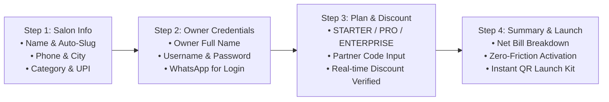

# Technical Requirements Document (TRD) & Security Architecture
## Universal Salon Onboarding & Enterprise Partner Panel

| Document Version | Author | Status | Target Systems |
| :--- | :--- | :--- | :--- |
| **2.0.0 (Comprehensive)** | Lead Enterprise & Security Architect | **APPROVED** | `apps/web`, `apps/api`, MySQL Database |

---

## 1. System Scope & Technical Objectives

This document establishes the technical and security foundation for two tightly coupled subsystems:
1. **The Universal Multi-Step Salon Onboarding Wizard (`<UniversalSalonOnboardingWizard />`)**: A single, clutter-free, responsive 4-step wizard reused across Public Self-Serve Registration (`/register`), Partner Assisted Onboarding (`/partner/onboard`), and Super Admin Provisioning (`/admin/onboarding`).
2. **The Enterprise Partner Panel Enhancements**:
   - Multi-identifier authentication (Email, Mobile Phone, or Username + Password).
   - Win-Win bilateral referral discount engine (Salon owner receives an upfront discount; partner receives recurring attribution).
   - Separation of saved payout methods (Profile Settings) from withdrawal execution (selection modal).
   - Full Indian banking schema validation (Bank Name, Holder Name, Acc No, IFSC regex, Account Type).
   - Unified dashboard shell reusing existing Admin/Owner components.

---

## 2. Universal Salon Onboarding Wizard Architecture

### 2.1 The 4 Clutter-Free Steps



### 2.2 Component Contract (`apps/web/components/onboarding/universal-onboarding-wizard.tsx`)

```typescript
export type OnboardingWizardMode = 'PUBLIC' | 'PARTNER' | 'ADMIN';

export interface UniversalWizardProps {
  mode: OnboardingWizardMode;
  initialPartnerCode?: string;       // Pre-filled if arrived via ?ref= or loaded in Partner Hub
  lockPartnerCode?: boolean;          // true in PARTNER mode (cannot be modified by field agent)
  onSuccessRedirectUrl?: string;     // Default: /owner/login or /partner/salons or /admin/tenants
  defaultPlan?: 'STARTER' | 'PRO' | 'ENTERPRISE';
  adminOverridesAllowed?: boolean;   // true only in ADMIN mode
}
```

### 2.3 Context-Mode Behavioral Matrix

| Feature / Behavior | `PUBLIC` Mode ([`/register`](file:///v:/salon/queue-engine-for-salon/apps/web/app/register/page.tsx)) | `PARTNER` Mode ([`/partner/onboard`](file:///v:/salon/queue-engine-for-salon/apps/web/app/partner/onboard/page.tsx)) | `ADMIN` Mode ([`/admin/onboarding`](file:///v:/salon/queue-engine-for-salon/apps/web/app/admin/onboarding/page.tsx)) |
| :--- | :--- | :--- | :--- |
| **Partner Code Field** | Optional promo input with *"Have a Partner Code? Get 10% OFF"* prompt. | Pre-filled with active partner's code, locked with a `🔒 Assigned Partner` badge. | Editable input with ability to search/assign any registered partner or leave blank. |
| **Live Discount Display** | Shows standard price vs discounted price in Step 3 & 4. | Shows live discount prominently to the barber on partner's tablet as a sales closer. | Admin can override discount percentage (0% to 100% free trial). |
| **Owner Credentials** | Owner chooses their own username and password. | Field agent guides owner to set a secure 6+ character password. | Admin can auto-generate credentials and send via SMS/WhatsApp. |
| **Post-Launch Redirection** | Routes directly to [`/owner/login`](file:///v:/salon/queue-engine-for-salon/apps/web/app/owner/login/page.tsx) with prefilled username. | Routes back to [`/partner/salons`](file:///v:/salon/queue-engine-for-salon/apps/web/app/partner/salons/page.tsx) with a success toast. | Routes to [`/admin/tenants`](file:///v:/salon/queue-engine-for-salon/apps/web/app/admin/tenants/page.tsx). |

---

## 3. Database Schema Evolution (`apps/api/src/db/schema.sql`)

### 3.1 Table: `partners` (Security & Complete Bank Fields)

```sql
ALTER TABLE partners 
  ADD COLUMN password_hash VARCHAR(255) NULL AFTER email,
  ADD COLUMN payout_holder_name VARCHAR(128) NULL AFTER payout_upi_id,
  ADD COLUMN payout_bank_name VARCHAR(128) NULL AFTER payout_holder_name,
  ADD COLUMN payout_account_type ENUM('SAVINGS', 'CURRENT') NOT NULL DEFAULT 'SAVINGS' AFTER payout_bank_ifsc;
```

Full updated DDL for reference:
```sql
CREATE TABLE IF NOT EXISTS partners (
  id VARCHAR(64) PRIMARY KEY,
  user_id VARCHAR(64) NULL,
  full_name VARCHAR(128) NOT NULL,
  phone VARCHAR(20) NOT NULL UNIQUE,
  email VARCHAR(128) NULL UNIQUE,
  password_hash VARCHAR(255) NOT NULL,
  city VARCHAR(64) NOT NULL,
  persona ENUM('CREATOR', 'GROUND_HUSTLER', 'SALON_OWNER', 'DEDICATED') NOT NULL DEFAULT 'GROUND_HUSTLER',
  referral_code VARCHAR(32) NOT NULL UNIQUE,
  status ENUM('PENDING_REVIEW', 'ACTIVE', 'PAUSED', 'REJECTED') NOT NULL DEFAULT 'PENDING_REVIEW',
  commission_model ENUM('RECURRING_PERCENT', 'FLAT_BOUNTY', 'HYBRID') NOT NULL DEFAULT 'RECURRING_PERCENT',
  commission_percent DECIMAL(5,2) NOT NULL DEFAULT 10.00,
  bounty_amount DECIMAL(10,2) NOT NULL DEFAULT 0.00,
  duration_type ENUM('LIFETIME', '3_MONTHS', '6_MONTHS', '12_MONTHS') NOT NULL DEFAULT '6_MONTHS',
  duration_end_date DATETIME NULL,
  is_commission_paused BOOLEAN NOT NULL DEFAULT FALSE,
  payout_upi_id VARCHAR(128) NULL,
  payout_holder_name VARCHAR(128) NULL,
  payout_bank_name VARCHAR(128) NULL,
  payout_bank_account VARCHAR(64) NULL,
  payout_bank_ifsc VARCHAR(32) NULL,
  payout_account_type ENUM('SAVINGS', 'CURRENT') NOT NULL DEFAULT 'SAVINGS',
  pitch_notes TEXT NULL,
  created_at DATETIME NOT NULL DEFAULT CURRENT_TIMESTAMP,
  updated_at DATETIME NOT NULL DEFAULT CURRENT_TIMESTAMP ON UPDATE CURRENT_TIMESTAMP,
  INDEX idx_partner_referral_code (referral_code),
  INDEX idx_partner_phone (phone),
  INDEX idx_partner_email (email)
);
```

### 3.2 Table: `platform_settings` (Referral Discount Configuration)
Store the global salon owner discount rate configured by Super Admin:
```sql
-- Inside platform_settings table or JSON config:
-- partner_salon_discount_percent: 10.00 (Default 10% discount on first plan purchase)
-- partner_salon_discount_type: 'PERCENTAGE' | 'FLAT_AMOUNT'
```

---

## 4. Enterprise REST API Contracts

### 4.1 Enterprise Partner Login
`POST /api/v1/partners/login`

**Security:** Password verified via `Bun.password.verify` (bcrypt). Throws `401 Unauthorized` on mismatch. Rate-limited to 5 failed attempts per IP/minute.

**Request:**
```json
{
  "identifier": "amit@example.com", // Accepts Email, Phone (+919876543210), or Referral Code (AMIT20)
  "password": "SecurePassword123"
}
```

**Response (200 OK):**
```json
{
  "success": true,
  "token": "part_sess_part_abc123_1731336000000",
  "partner": {
    "id": "part_abc123",
    "fullName": "Amit Verma",
    "referralCode": "AMIT20",
    "persona": "GROUND_HUSTLER",
    "status": "ACTIVE"
  }
}
```

---

### 4.2 Partner Code Validation & Live Discount Quote
`GET /api/v1/partners/verify-code?code=AMIT20&plan=PRO`

Used by `<UniversalSalonOnboardingWizard />` during Step 3 to validate promo code and quote exact rupee discount before submission.

**Response (200 OK):**
```json
{
  "success": true,
  "isValid": true,
  "partner": {
    "id": "part_abc123",
    "fullName": "Amit Verma",
    "city": "Bareilly"
  },
  "discount": {
    "type": "PERCENTAGE",
    "value": 10.0,
    "grossPlanPrice": 999.00,
    "discountAmount": 99.90,
    "netPayableAmount": 899.10,
    "message": "Special 10% Partner Discount applied!"
  }
}
```

---

### 4.3 Payout Methods Management (Profile Settings)
`PUT /api/v1/partners/me/payout-methods`

Allows partner to update verified payout destinations without having to type them during withdrawal execution.

**Request:**
```json
{
  "payoutUpiId": "amit@okhdfcbank",
  "payoutHolderName": "Amit Kumar Verma",
  "payoutBankName": "HDFC Bank Ltd",
  "payoutBankAccount": "50100234567890",
  "payoutBankIfsc": "HDFC0000123",
  "payoutAccountType": "CURRENT"
}
```

---

### 4.4 Withdrawal Execution (Option Selection Only)
`POST /api/v1/partners/me/payout`

**Security:** User selects payout method; the backend reads the verified account details directly from the partner record in the database. Prevents malicious payload injection of arbitrary third-party accounts.

**Request:**
```json
{
  "amount": 1500.00,
  "payoutMethod": "UPI" // or "BANK_TRANSFER"
}
```

---

## 5. Security & Threat Modeling

| Threat Category | Potential Attack Vector | Architectural Mitigation & Defense |
| :--- | :--- | :--- |
| **1. Credential Stuffing & Brute Force** | Rapid automated password attempts on `/api/v1/partners/login` | In-memory sliding window rate limiter (max 5 failed attempts per 60 seconds per IP). Constant-time bcrypt comparison (`Bun.password.verify`). |
| **2. Arbitrary Account Exfiltration** | Attacker injects a third-party bank account into withdrawal POST payload | **Separation of Payout Profile:** The withdrawal endpoint accepts only `{ amount, payoutMethod: "UPI" | "BANK_TRANSFER" }`. Account details are fetched server-side from the authenticated partner's profile. |
| **3. Discount Tampering in Frontend** | User edits client JSON to send `discountAmount: 999` on a ₹999 plan | **Server-Side Price Authority:** The client only transmits `planTier` and `partnerCode`. The backend recalculates gross price, partner validity, discount percentage, and net payable amount atomically during onboarding. |
| **4. Double-Withdrawal Race Condition** | Attacker fires two concurrent withdrawal requests simultaneously | Database transaction with `SELECT ... FOR UPDATE` or atomic balance check before inserting `WITHDRAWAL_DEBIT` ledger record. |
| **5. Invalid IFSC Phishing / Typos** | Partner types incorrect IFSC causing banking failure or misdirected funds | Strict regex enforcement: `^[A-Z]{4}0[A-Z0-9]{6}$` (4 letters, literal zero, 6 alphanumeric characters). Forced uppercase sanitization. |
| **6. XSS / Script Injection in Notes** | Submitting malicious scripts in `pitchNotes` or `fullName` | Content-Security-Policy headers, HTML entity escaping, and strict TypeBox validation schemas. |
| **7. Privilege Escalation** | A `HOST_PARTNER` attempting to access `/api/v1/admin/*` endpoints | Role-based token guard checking `user.role === 'SUPER_ADMIN'`. Partner sessions carry distinct token signatures rejected by administrative middleware. |

---

## 6. Enterprise UI Reusability Blueprint

### 6.1 Layout Shell Consolidation
Instead of creating divergent CSS styles:
- [`apps/web/app/partner/layout.tsx`](file:///v:/salon/queue-engine-for-salon/apps/web/app/partner/layout.tsx) imports the standardized dashboard shell components:
  - Responsive collapsible sidebar with active route highlights.
  - Global topbar with breadcrumbs, in-app notification center bell, and partner wallet balance pill.
  - Mobile bottom navigation dock for 1-thumb touch access on Android devices.

### 6.2 The Unified Wizard Steps UI Hierarchy
Inside [`apps/web/components/onboarding/universal-onboarding-wizard.tsx`](file:///v:/salon/queue-engine-for-salon/apps/web/components/onboarding/universal-onboarding-wizard.tsx):
- **Progress Header:** 4-step interactive stepper with step indicator, completion checkmarks, and percentage bar.
- **Form Card:** Clean, high-contrast dark-mode card utilizing `shadcn/ui` form primitives.
- **Floating Bottom Bar:** Sticky on mobile with `[ Back ]` and `[ Continue to Step X -> ]` buttons featuring generous 48px touch targets.
