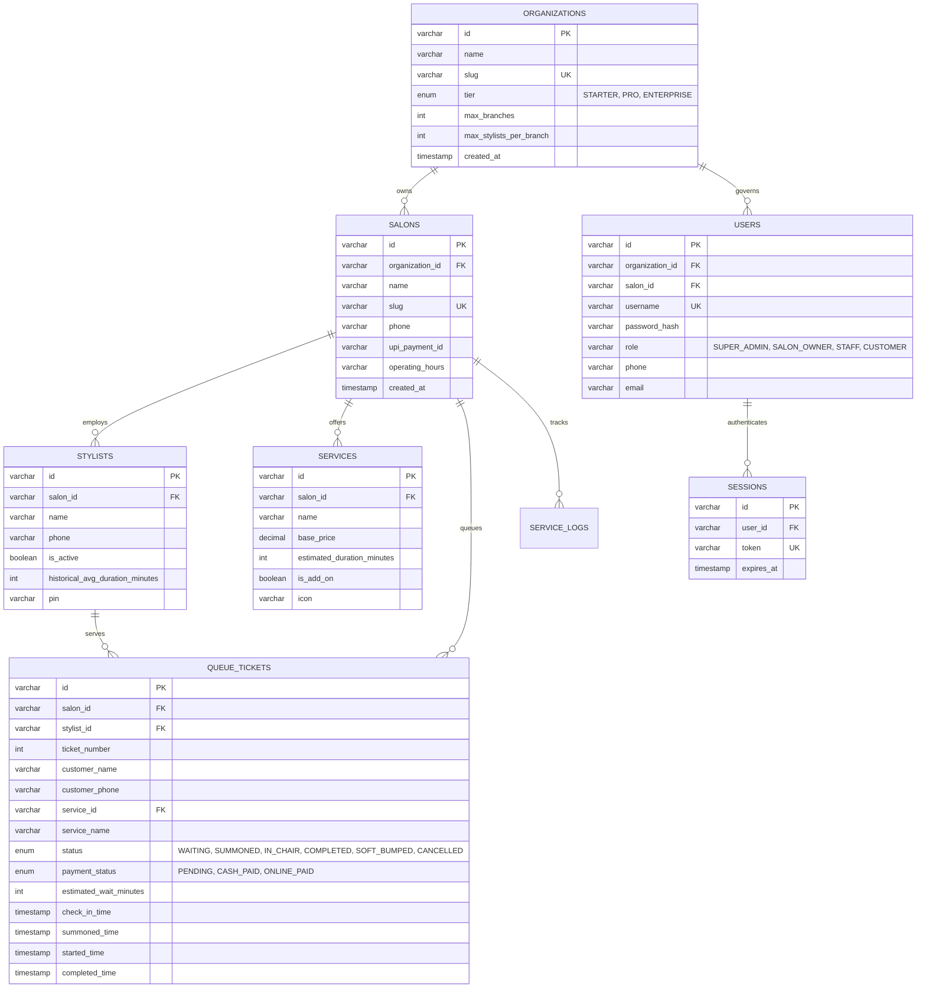

# Database Schema & Entity Relationship Diagram (ERD)

**Engine:** MySQL 8.0 / 9.1 (InnoDB)  
**Encoding:** `utf8mb4` | `utf8mb4_unicode_ci`  
**Connection Mode:** Connection Pool with Resilient In-Memory Fallback  

---

## 1. Entity Relationship Diagram

---

## 2. Table Indexing & Performance Rules
1. `queue_tickets`: Indexed on `(salon_id, status, check_in_time)` for microsecond queue lookups.
2. `stylists`: Indexed on `(salon_id, is_active)` to filter active chair availability instantly.
3. `services`: Indexed on `(salon_id, is_add_on)` for sub-50ms catalog responses.
4. `sessions`: Indexed on `(token)` for zero-delay token authentication.
