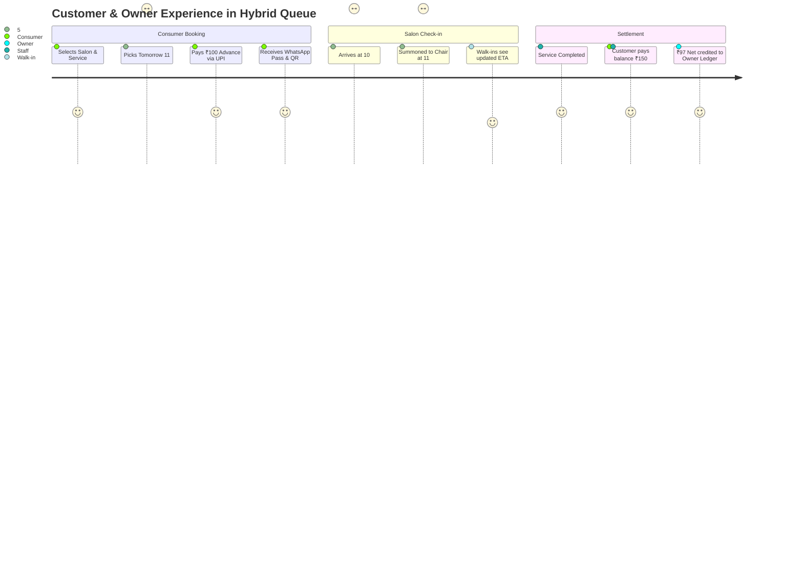

# Product Requirements Document (PRD): Hybrid Appointment Booking & Queue Engine

## 1. Document Overview
- **Feature Name:** Hybrid Appointment Booking & Fair Queue Interleaving Engine
- **Target Subsystem:** Advance Scheduled Bookings, Prepaid Platform Escrow, Dynamic Wait-Time Buffer, and Salon Payout Ledger
- **Target Audiences:**
  1. **B2C Salon Consumers:** Booking guaranteed future time slots (e.g., tomorrow 11:00 AM) with prepaid token advance to skip long wait times.
  2. **Walk-in Customers:** Joining the immediate live physical queue via door QR without being unfairly displaced.
  3. **Salon Owners & Staff:** Managing chairs, viewing a unified calendar + queue timeline, and receiving automated daily bank payouts ($T+1$).
  4. **Platform Super Admin:** Overseeing platform escrow balances, gateway processing fees (2%), platform commission (1%), and payout batch disbursements.
- **Status:** Approved for Implementation

---

## 2. Problem Statement & Business Opportunity
Traditional appointment solutions fail in Indian neighborhood salons for three reasons:
1. **The Walk-in Collision Conflict:** If an advance appointment customer arrives at 3:00 PM while 3 walk-ins are waiting, seating the appointment customer immediately makes walk-ins feel cheated. Conversely, forcing the appointment customer to wait defeats the purpose of advance booking.
2. **Payment Trust & Phantom Bookings:** Unpaid appointments result in 35%–50% no-show rates, leaving barbers with empty chairs and zero revenue.
3. **Manual UPI Approval Bottleneck:** If appointments route to the salon owner's personal UPI QR, the owner must manually verify the UTR reference. When busy cutting hair, the appointment stays "Pending", making consumers anxious and suspicious of being scammed.

### The Solution:
- **Prepaid Escrow via Platform Gateway:** Instant confirmation via UPI / NetBanking / Razorpay. Zero manual approval delays.
- **Fair Interleaving Engine:** Appointment slots are pre-allocated into the live queue wait-time calculator as scheduled time buffers, so walk-ins know the exact realistic wait time upfront.
- **10-Minute Grace Window & No-Show Auto-Release:** If an appointment customer is $>10$ minutes late, their seat is automatically handed to the next waiting walk-in ticket, ensuring barbers are never idle.
- **Automated $T+1$ Daily Payouts:** Platform deducts 2% gateway fee + 1% platform commission and batches the remaining 97% to the salon owner's bank account every midnight.

---

## 3. Goals & Success Metrics
- **Zero Walk-in Frustration:** 100% of walk-in wait times factor in booked appointment slots in real time.
- **Sub-3-Second Booking Confirmation:** Instant online payment verification through Razorpay / Platform UPI escrow.
- **< 5% No-Show Rate:** Prepaid token advance (e.g., ₹50 or full service cost) locks in customer commitment.
- **Zero Barber Idle Downtime:** Auto-fallback to walk-in queue if an appointment customer is $>10$ minutes late or completes service early.
- **100% Predictable Payouts:** Daily automated $T+1$ settlement to salon owner bank accounts with complete audit transparency.

---

## 4. User Personas & Core Journeys

### 4.1 Persona 1: Consumer (Rohan) - Advance Booking
1. Rohan visits salon web storefront (`/s/[slug]/book`).
2. Selects service: "Haircut + Beard Styling" (Total: ₹350, Duration: 40 mins).
3. Selects date & slot: "Tomorrow at 11:00 AM" with Stylist "Vikas".
4. Chooses payment option:
   - **Full Advance (₹350)** or **Booking Deposit (₹100)**.
5. Pays via UPI / QR. Payment confirms instantly in <2 seconds.
6. Rohan receives WhatsApp digital booking pass with arrival instructions and QR check-in code.

### 4.2 Persona 2: Walk-in Customer (Amit) - Door QR Scan
1. Amit walks in at 10:30 AM and scans the lobby QR code (`/s/[slug]/queue`).
2. The system checks barber Vikas's schedule:
   - Current chair finishes at 10:45 AM.
   - An advance booking (Rohan) is scheduled from 11:00 AM to 11:40 AM.
3. If Amit's requested service is a quick 15-minute trim, the system fits Amit in between 10:45 AM – 11:00 AM!
4. If Amit wants a 45-minute service, the system sets his realistic ETA to 11:40 AM:
   > *"Estimated chair time: 11:40 AM (Includes scheduled booking 11:00 AM–11:40 AM)."*
5. Amit feels respected because the timeline is fully transparent from minute one.

### 4.3 Persona 3: Salon Owner (Suresh) - Daily Settlement
1. Suresh logs in to `/owner/appointments` and sees upcoming bookings and chair assignments.
2. At the end of the day, Suresh visits `/owner/payouts`:
   - Gross appointment collections: ₹4,000
   - Platform fee (1%): -₹40
   - Gateway processing (2%): -₹80
   - Net payout to bank: ₹3,880
3. Payout triggers automatically at 12:00 AM midnight via payout gateway (Razorpay Route / Cashfree Payouts / IMPS).

---

## 5. Functional Requirements Across All Portals

| Portal / Role | Key Functional Capabilities |
| :--- | :--- |
| **Consumer Booking Portal** (`/s/[slug]/book` & `/s/[slug]/appointment/[id]`) | • Real-time calendar slot picker with stylist selection. • Instant payment gateway checkout (UPI, Card, NetBanking). • Digital ticket pass with live countdown and WhatsApp confirmation. • **1-Tap Self-Service Rescheduling:** Consumers can shift slots (e.g. 12:00 PM to 10:00 AM or next day) up to 1 hour before scheduled time with ₹0 penalty; prepaid deposit rolls over seamlessly. |
| **Walk-in Queue Portal** (`/s/[slug]/queue`) | • Dynamic ETA calculation interleaving active tickets + appointment buffers. • Transparent "Next Available Walk-in Seat" messaging. |
| **Lobby TV Mirror** (`/s/[slug]/tv`) | • Airport-style dual-column display: "Current In-Chair" & "Next Up" (Walk-ins + Appointments clearly marked). • Audio chimes on customer summoning. |
| **Barber / Staff Station** (`/owner/station`) | • Visual chair schedule with upcoming appointments. • 1-tap "Summon Customer", "Start Service", and "Complete Service". • Auto-bump / "No-Show" toggle if appointment $>10$ mins late. |
| **Salon Owner Hub** (`/owner/payouts` & `/owner/appointments`) | • Toggle appointment capability On/Off per branch. • Set booking deposit rules (Fixed ₹100 or % of service). • Bank account / UPI VPA configuration for automated payouts. • Real-time passbook ledger showing gross revenue, deductions, and payouts. |
| **Super Admin Command Center** (`/admin/appointments` & `/admin/payouts`) | • Platform-wide appointment volume and GMV monitoring. • Escrow holding balance tracker. • Gateway fee split calibrator (e.g., 2% PG + 1% Platform Fee). • Manual payout retry and compliance audit logs. |

---

## 6. Financial Settlement & Escrow Model

$$P_{\text{net}} = P_{\text{gross}} - (P_{\text{gross}} \times 0.02) - (P_{\text{gross}} \times 0.01) = P_{\text{gross}} \times 0.97$$

1. **Escrow Holding:** Payments sit in the platform escrow account until the service is marked `COMPLETED` or the appointment time passes without salon cancellation.
2. **Customer Cancellation Policy:**
   - Cancel $>2$ hours before slot: 100% refund to consumer source account.
   - Cancel $<2$ hours before slot: 50% cancellation fee credited to salon owner, 50% refunded to consumer.
   - Customer No-Show: 100% of advance credited to salon owner ledger (minus platform fee).
3. **Salon Cancellation:**
   - If the salon cancels, 100% refund is instantly initiated to the customer, plus optional ₹50 loyalty wallet compensation.
