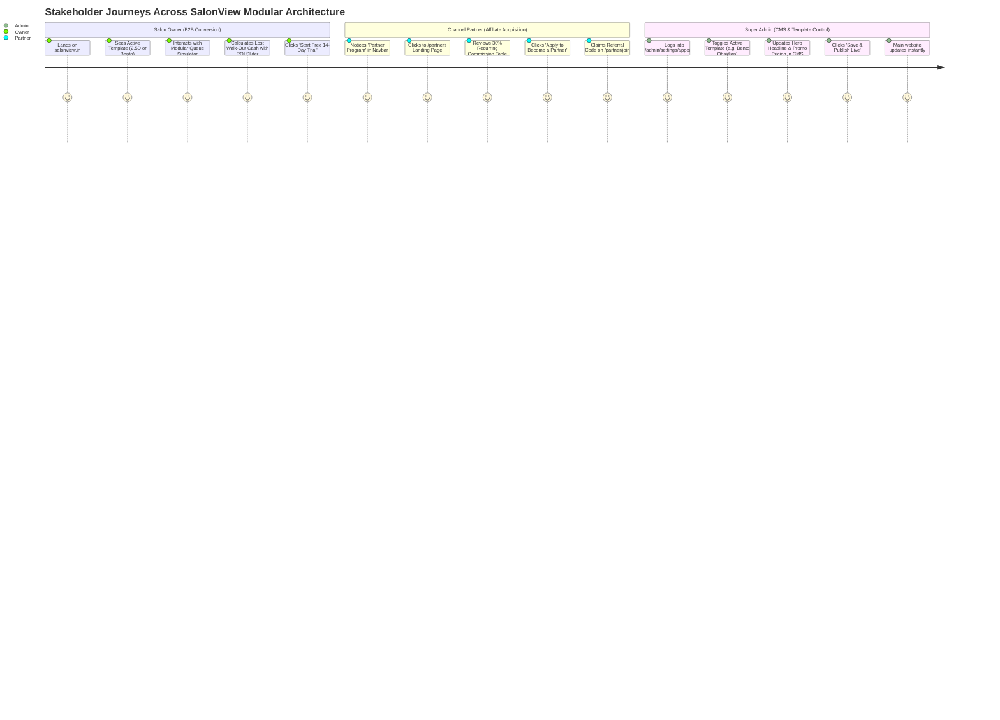

# Product Requirements Document (PRD): Dynamic Modular Landing Engine & Headless Brand CMS

## 1. Document Overview
- **Feature Name:** Dynamic Modular Landing Engine & Headless Brand CMS
- **Brand Target:** SalonView (Universal Salon Operations & Real-Time Queue Engine)
- **Target Subsystems:**
  1. **Atomic Section Modularization Registry (`SECTION_REGISTRY`):** Composable, self-contained UI building blocks for infinitely extensible landing page templates.
  2. **Multi-Template Layout Factory:** Instant switching between pre-orchestrated layouts (`2_5D_SCROLL`, `BENTO_OBSIDIAN`, `MINIMALIST_LUXE`) and custom section arrangements.
  3. **Admin-Controlled Template Switcher & Fallback:** 1-click active design selector with instant zero-downtime rollback safety net.
  4. **Headless In-Memory Platform CMS:** Dynamic copy, pricing tiers, brand identity, and support channels editable without redeployment.
  5. **Dedicated Channel Partner Hub (`/partners`):** High-converting B2B reseller acquisition funnel linking directly into `/partner/join`.
  6. **Zero-Friction Decoupled Rebranding:** Decoupled operational routes (`/s/[slug]`) and Cloudflare 301 edge preservation.
- **Target Stakeholders:**
  - **Salon Owners (85% Homepage Focus):** High-converting B2B SaaS pitch focused on eliminating weekend walk-outs, live TV departure lounge mirrors, and doubling daily chair turnover.
  - **Channel Partners & Resellers (15% Focus):** Dedicated `/partners` funnel offering 25%–35% recurring monthly commissions.
  - **Consumers (Dedicated Routes):** Cleanly served via salon-specific links (`/s/[slug]`, `/s/[slug]/queue`) with an SEO pathway for future city directories (`/explore`).
  - **Super Admin:** Full real-time control over active templates, sections, and marketing copy without code deployments.
- **Status:** Approved for Implementation

---

## 2. Problem Statement & The Modularization Imperative

### 2.1 The Traditional Landing Page Failure Modes:
1. **The Monolithic Spaghetti Trap:** Startups frequently create separate 1,500-line monolithic files for every landing page experiment or design variant (e.g. `page-v1.tsx`, `page-v2.tsx`, `page-holiday.tsx`). This duplicates complex logic (like interactive queue simulators, ROI calculators, and pricing tiers), creating severe technical debt and visual divergence.
2. **The Hardcoded Copy Bottleneck:** Changing a marketing headline, testing a ₹999 vs. ₹1,499 pricing strategy, or updating a support WhatsApp number requires developer intervention, git commits, code reviews, and server rebuilds.
3. **The Multi-Audience Dilemma:** Trying to speak equally to Salon Owners, Consumers, and Partners on a single homepage creates cognitive overload, converting zero stakeholders.
4. **The Rebranding Fear:** Founders often freeze progress because changing a brand name later risks breaking physical QR stickers, print brochures, and customer bookmarks.

### 2.2 The Modular Architecture Solution:
* **Atomic Section Modularization Philosophy:** Every visual block of the landing page is engineered as an isolated, typed, self-contained React component (`apps/web/components/landing/*`):
  - `<LandingNavbar />`: Global brand header with logo, live telemetry pulse, nav links, and `/partners` portal button.
  - `<Hero2Point5D />`: Isometric pseudo-3D visual showcase featuring tilted customer pocket ticket and ambient TV mirror preview.
  - `<HeroBento />`: High-contrast Linear/Vercel-style bento-grid layout with active WebSocket telemetry badges.
  - `<HeroMinimalist />`: Ultra-clean, typography-first hero focused on rapid loading and direct value propositions.
  - `<QueueSimulator />`: Interactive working simulator where visitors click "Call Next Customer" to trigger live ticket increment and simulated WhatsApp alert.
  - `<TvMirrorPreview />`: Fullscreen preview of the ambient Waiting Lounge TV Mirror (`/s/[slug]/tv`).
  - `<DynamicUpiShowcase />`: Visual preview of NPCI-compliant client-rendered UPI QR code with 0% gateway fee badge.
  - `<RoiCalculator />`: Interactive tactile slider calculating monthly lost revenue from crowded waiting benches.
  - `<PricingSection />`: Tier cards (Starter ₹699, Pro ₹1,499, Elite ₹3,499) rendered dynamically from configuration.
  - `<PartnerBanner />`: High-impact reseller callout banner routing directly to `/partners`.
  - `<FaqAccordion />`: Accessible collapsible FAQ addressing salon owner objections.
  - `<LandingFooter />`: Brand footer with legal links, white-label disclaimer, and social channels.
* **The Section Registry Pattern (`SECTION_REGISTRY`):** A centralized dictionary maps unique string identifiers (`'hero'`, `'simulator'`, `'tv_mirror'`, `'upi'`, `'roi'`, `'pricing'`, `'partners'`, `'faq'`) to their respective components.
* **Declarative Template Manifests:** A "landing page" is simply a declarative manifest specifying an ordered array of section IDs and variant options. Adding a completely new landing page in the future requires $< 20$ lines of code, reusing existing battle-tested sections without code duplication.
* **1-Click Admin Template Switcher:** Super Admin can switch between active templates (`2_5D_SCROLL`, `BENTO_OBSIDIAN`, or `MINIMALIST_LUXE`) directly from `/admin/settings/appearance`, with instant zero-downtime rollback.
* **In-Memory Headless CMS:** Dynamic brand copy, pricing tiers, and contact points served from Bun's in-memory cache in sub-10ms (conforming to Rule 2 of `GEMINI.md`).
* **Dedicated Partner Ingestion Funnel:** Main homepage features a dedicated partner entrypoint routing to `/partners`, which converts resellers with clear commission calculators and links directly to our existing `/partner/join` onboarding flow.
* **Zero-Broken-Link Forwarding:** The `/s/[slug]` structure decouples salons from platform names, while Cloudflare 301 edge rules preserve all printed QR stickers forever.

---

## 3. Goals & Success Metrics

- **Sub-50ms Dynamic Config Delivery:** 100% of public landing page configurations served in $<10\text{ms}$ from memory.
- **100% DRY Modular Component Reusability:** Zero duplicated UI logic across landing page templates; all sections composed from `apps/web/components/landing/`.
- **Zero-Downtime Template Switch & Fallback:** Super Admin can flip between active templates in $<1\text{ second}$ without redeployment.
- **Zero Hardcoded Marketing Copy:** 100% of hero headlines, pricing numbers, partner commission percentages, and support contacts are dynamically fed from the CMS.
- **Sub-2-Minute Partner Onboarding:** Seamless transition from `/partners` marketing overview to `/partner/join` registration.

---

## 4. User Personas & Core Journeys

---

## 5. Functional Requirements

### 5.1 Section Modularization System
All landing page templates must be composed from dedicated, isolated components in `apps/web/components/landing/`:
1. `<LandingNavbar />`: Global brand header with logo, live telemetry pill, navigation links, and `/partners` button.
2. `<Hero2Point5D />`: Isometric pseudo-3D visual showcase featuring tilted customer pocket ticket and ambient TV mirror preview.
3. `<HeroBento />`: High-contrast Linear/Vercel-style bento-grid layout with active WebSocket telemetry badges.
4. `<HeroMinimalist />`: Modern minimalist typography-driven hero for lightning-fast lightweight presentations.
5. `<QueueSimulator />`: Interactive working simulator where visitors click "Call Next Customer" to trigger live ticket increment and simulated WhatsApp alert.
6. `<TvMirrorPreview />`: Fullscreen preview of the ambient Waiting Lounge TV Mirror (`/s/[slug]/tv`).
7. `<DynamicUpiShowcase />`: Visual preview of NPCI-compliant client-rendered UPI QR code with 0% gateway fee badge.
8. `<RoiCalculator />`: Interactive tactile slider calculating monthly lost revenue from crowded waiting benches.
9. `<PricingSection />`: Tier cards (Starter ₹699, Pro ₹1,499, Elite ₹3,499) rendered dynamically from configuration.
10. `<PartnerBanner />`: High-impact reseller callout banner routing directly to `/partners`.
11. `<FaqAccordion />`: Accessible collapsible FAQ addressing owner questions.
12. `<LandingFooter />`: Brand footer with legal links, white-label disclaimer, and social links.

### 5.2 Dynamic Landing Page CMS (Admin Controlled)
The Super Admin portal at `/admin/settings/appearance` must expose:
- **Active Template Selector:** Visual cards for selecting `2_5D_SCROLL`, `BENTO_OBSIDIAN`, or `MINIMALIST_LUXE`.
- **Modular Section Toggles:** Ability to enable/disable individual sections (`queueSimulator`, `tvMirror`, `upiShowcase`, `roiCalculator`, `pricing`, `partnerBanner`, `faq`).
- **Core Identity Fields:** Brand Name, Tagline, Logo URL.
- **Hero Copy Editor:** Badge text, Main Headline, Subheadline, CTA button text.
- **Pricing Editor:** Monthly rates for Starter, Pro, and Elite tiers.
- **Partner Program Editor:** Commission percentage and promotional pitch.
- **Contact & Social Fields:** WhatsApp support number, support email, Instagram/X handles.

### 5.3 Dedicated Partner Marketing Hub (`/partners`)
A public-facing landing page at `apps/web/app/partners/page.tsx` featuring:
- Value proposition for local distributors, agencies, and freelance sales reps.
- Passive income recurring commission calculator (10 salons, 30 salons, 75 salons).
- 4-pillar benefits: Zero tech overhead, free physical acrylic counter stand kits, automated UPI monthly payouts, territory protection.
- Direct CTA linking to `/partner/join?source=partners_landing`.

### 5.4 Future Consumer Directory Hook (`/explore`)
- Architecture allows zero-impact introduction of `/explore` (search by city and neighborhood) when salon density reaches $>100$ locations.
- Homepage navigation provides a clean, subtle search link for guests holding existing tickets.

---

## 6. Non-Functional & Performance Requirements

1. **Sub-50ms Latency (Rule 2 of GEMINI.md):** Dynamic configuration cached in Bun server memory with TTL (60s) and immediate cache invalidation on admin update.
2. **Mobile Hardware Offloading (Rule 1 & 7 of GEMINI.md):** 2.5D visual effects implemented using CSS hardware-accelerated transforms (`perspective`, `rotateX`, `rotateY`) and lightweight Framer Motion, without loading heavy WebGL/Three.js bundles.
3. **Accessibility & Zero Dialogs (Rule 4 of GEMINI.md):** WCAG AAA contrast ratios across Obsidian Noir (`#0B0F17`) and Hyper Emerald (`#10B981`); zero blocking `alert()` calls.
4. **Type-Safe Schema & SonarQube Compliance:** Zero untyped `any` parameters; strict Zod validation on API boundaries.
