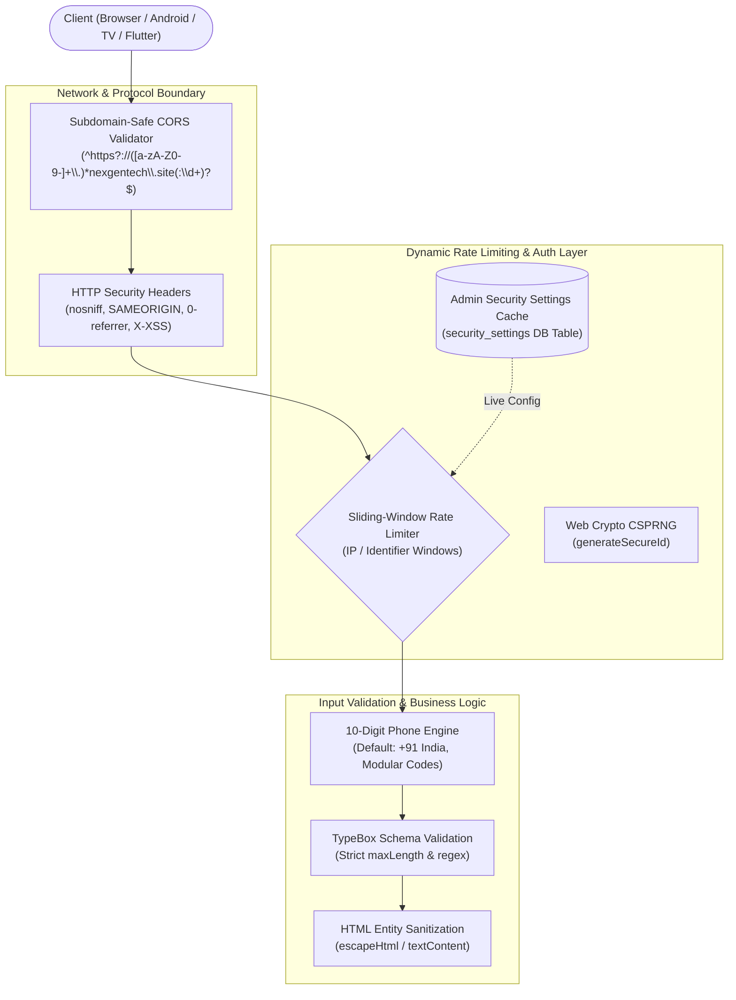

# Engine Que System — Developer Security & Architecture Guide
**Document Version:** 1.0.0  
**Target Audience:** Development Agents, Full-Stack Engineers & Platform Operators  
**Applicable Scope:** `apps/api` (Bun / ElysiaJS backend), `apps/web` (Next.js 16 frontend), Static Operator Portals (`apps/api/src/public/*.html`), and future Mobile/Flutter Clients  
**Audit & Hardening Completion:** November 14, 2026  

---

## 1. Architectural Overview & Security Mandate

As part of the enterprise security hardening initiative, the entire `queue-engine-for-salon` application was fortified against OWASP Top 10 vulnerabilities, brute-force exploitation, credential attacks, cross-site scripting (XSS), and CORS domain bypasses.

Crucially, **no security thresholds are hardcoded**. All rate limits, time windows, allowed origins, and supported country codes are dynamically governed by the **Super Admin** through persistent configuration (`security_settings` table in MySQL and real-time in-memory caching).



---

## 2. Dynamic Admin Security Settings API

The Super Admin has complete authority to configure security policies in real-time without modifying code or restarting servers.

### 2.1 Storage & Cache Model
- **Database Table:** `security_settings`
- **In-Memory Cache:** `memoryStore.securitySettings` (provides sub-millisecond retrieval adhering to the *Zero Server Waste* mandate in `GEMINI.md`).
- **Default Seed:** Auto-seeded on server startup if not already initialized.

### 2.2 Endpoints Reference

#### `GET /api/admin/security/settings`
Retrieves current live security settings.
- **Authorization:** `Bearer <admin_session_token>`
- **Response Schema:**
```json
{
  "success": true,
  "settings": {
    "loginRateLimitAttempts": 5,
    "loginRateLimitWindowSeconds": 300,
    "pinSwitchRateLimitAttempts": 5,
    "pinSwitchRateLimitWindowSeconds": 180,
    "checkinRateLimitAttempts": 10,
    "checkinRateLimitWindowSeconds": 60,
    "allowedOrigins": [
      "https://nexgentech.site",
      "https://admin.nexgentech.site",
      "http://localhost:3000",
      "http://localhost:3001"
    ],
    "supportedCountryCodes": [
      { "code": "+91", "country": "India", "isDefault": true },
      { "code": "+1", "country": "USA / Canada", "isDefault": false },
      { "code": "+44", "country": "United Kingdom", "isDefault": false },
      { "code": "+971", "country": "United Arab Emirates", "isDefault": false },
      { "code": "+65", "country": "Singapore", "isDefault": false },
      { "code": "+61", "country": "Australia", "isDefault": false }
    ],
    "updatedAt": "2026-11-14T02:00:00.000Z"
  }
}
```

#### `PUT /api/admin/security/settings`
Updates security settings dynamically. Takes effect immediately for all subsequent incoming requests.
- **Authorization:** `Bearer <admin_session_token>`
- **Request Body:** Partial or complete object matching the settings schema.
- **Validation:** Clamped numerical limits (minimum 1 attempt, minimum 5 seconds window) and strict array structures.

### 2.3 Frontend API Client Integration (`apps/web/lib/api.ts`)
The web application provides direct typed access to the security settings API:
```typescript
import { api } from "@/lib/api";

// Fetch live security settings
const { settings } = await api.admin.getSecuritySettings();

// Update dynamic limits, CORS origins, and country codes
await api.admin.updateSecuritySettings({
  loginRateLimitAttempts: 5,
  loginRateLimitWindowSeconds: 300,
  pinSwitchRateLimitAttempts: 5,
  pinSwitchRateLimitWindowSeconds: 180,
  checkinRateLimitAttempts: 10,
  checkinRateLimitWindowSeconds: 60,
  allowedOrigins: ["https://nexgentech.site", "https://admin.nexgentech.site"],
  supportedCountryCodes: [
    { code: "+91", country: "India", isDefault: true },
    { code: "+1", country: "USA / Canada", isDefault: false }
  ]
});
```

### 2.4 Admin Visual Security Cockpit (`apps/web/app/admin/security/page.tsx`)
A real-time, interactive security management cockpit is integrated directly into the Super Admin dashboard at `/admin/security`:
1. **Dynamic Rate Limiting Controls:** Numerical stepper inputs with interactive sliders allowing instant adjustment of login brute-force thresholds, mirror tablet PIN switch guards, and public door QR check-in limits.
2. **Allowed Origins & Cloudflare Tunnels Manager:**
   - Displays protected apex and wildcard domain entries (`https://nexgentech.site`, `https://*.nexgentech.site`, `http://localhost:3000`).
   - Add/remove custom allowed origins with instant URL format validation.
   - Live Cloudflare Telemetry Badge indicating `Cloudflare cf-connecting-ip Active` and transparent tunnel status.
3. **Regional Country Codes & Mobile Policy:**
   - Select default country code for the platform (defaults to `+91 India`).
   - Interactive toggle chips to enable/disable international codes (`+1`, `+44`, `+971`, `+65`, `+61`).
4. **Instant Hot-Reload Feedback:** Saves changes via `api.admin.updateSecuritySettings` and triggers a non-intrusive toast alert without requiring server restart or page refresh.

---

## 3. Subdomain-Safe CORS Validator & Security Headers

### 3.1 Wildcard Subdomain Regex
To fulfill the requirement that `nexgentech.site` and **all its subdomains** (`*.nexgentech.site`) are allowed while blocking malicious spoofing attempts (e.g. `evil-nexgentech.site` or `nexgentech.site.attacker.com`):

**Source:** `apps/api/src/security/cors-validator.ts`
```typescript
const NEXGENTECH_REGEX = /^https?:\/\/([a-zA-Z0-9-]+\.)*nexgentech\.site(:\d+)?$/i;
```

### 3.2 Dynamic Allowed Origins Resolution
`isAllowedOrigin(origin, adminAllowedOrigins)` checks:
1. Missing origin (direct server-to-server or mobile app / Flutter requests) $\rightarrow$ **Allowed**.
2. Loopback/development origins (`http://localhost:*`, `http://127.0.0.1:*`) $\rightarrow$ **Allowed**.
3. Anchored `*.nexgentech.site` matching `NEXGENTECH_REGEX` $\rightarrow$ **Allowed**.
4. Custom origins explicitly configured by Admin in `security_settings.allowedOrigins` $\rightarrow$ **Allowed**.
5. All other origins $\rightarrow$ **Rejected** (returns `false`, browser blocks response).

### 3.3 HTTP Defensive Headers
Applied globally in `apps/api/src/security/headers.ts`:
- `X-Content-Type-Options: nosniff` (Prevents MIME-sniffing drive-by downloads).
- `X-Frame-Options: SAMEORIGIN` (Mitigates clickjacking attacks).
- `X-XSS-Protection: 1; mode=block` (Legacy browser XSS audit trigger).
- `Referrer-Policy: strict-origin-when-cross-origin` (Prevents leaking session tokens or PII via Referer headers).

### 3.4 Cloudflare Security & Tunnel Proxy Isolation
When deployed behind Cloudflare (such as via `cloudflared` tunnel to `nexgentech.site`), all client traffic passes through Cloudflare edge nodes.
To prevent the reverse proxy IP from collapsing all legitimate customer requests into a single IP bucket (which would cause false-positive rate limit blocks):
1. **Header Evaluation Priority:** `rateLimiter.getClientIp(req)` strictly inspects headers in order:
   - `cf-connecting-ip` (Cloudflare authoritative client IP)
   - `x-forwarded-for` (standard proxy chain, takes first comma-separated client IP)
   - `x-real-ip` (fallback proxy header)
   - Socket remote address (local fallback)
2. **Tunnel Subdomain Integrity:** All wildcard subdomains (`salon1.nexgentech.site`, `kiosk.nexgentech.site`, `partner.nexgentech.site`) are verified against `NEXGENTECH_REGEX`, ensuring end-to-end TLS and CORS protection without manual origin white-listing.

---

## 4. Standardized 10-Digit Mobile Phone Engine & Country Codes

### 4.1 Specification
- **Core Mobile Number:** Exactly **10 digits** (`[0-9]{10}`).
- **Country Code:** Defaults to `+91` (India 🇮🇳) and extensible to any valid E.164 country prefix (`+1`, `+44`, `+971`, etc.).
- **Stored Format:** E.164 international standard (`+919876543210`) or cleanly separated `{ countryCode: "+91", nationalNumber: "9876543210" }`.

### 4.2 Backend Validator (`apps/api/src/security/phone-validator.ts`)
```typescript
import { phoneValidator } from '../security/phone-validator';

// 1. Validate full phone with optional country code
const res = phoneValidator.validatePhone('9876543210', '+91');
// -> { valid: true, countryCode: "+91", nationalNumber: "9876543210", e164: "+919876543210" }

// 2. Strict 10-digit national number check
phoneValidator.is10DigitNumber('9876543210'); // true
phoneValidator.is10DigitNumber('987654321');  // false (9 digits)
phoneValidator.is10DigitNumber('98765432100'); // false (11 digits)
```

### 4.3 Frontend Universal `PhoneInput` Component (`apps/web/components/ui/phone-input.tsx`)

A unified, reusable, mobile-first phone input component has been implemented and deployed across all frontend routes:

```tsx
import { PhoneInput } from "@/components/ui/phone-input";

<PhoneInput
  value={phone}
  onChange={setPhone}
  countryCode={countryCode}
  onCountryCodeChange={setCountryCode}
  placeholder="9876543210"
  showDigitCounter={true}
  required
/>
```

#### Real-Time Input-Time Enforcement Features:
1. **Physical Keystroke Clamping (`maxLength={10}`):** The HTML input element actively blocks users from typing an 11th digit. Keystrokes past 10 digits are ignored.
2. **Real-time Non-Digit Stripping:** All spaces, hyphens, brackets, and non-numeric characters are automatically stripped via `\D` regex at input time.
3. **Pasted E.164 Number Auto-Detection:** If a user pastes a full international number (e.g. `+91 98765 43210`), the component automatically detects the matching country code (`+91`), switches the dropdown, and extracts the 10-digit national number (`9876543210`).
4. **Live Visual Digit Counter & State Transitions:**
   - **Empty (`0/10`):** Neutral slate border and helper label `"National mobile number (10 digits)"`.
   - **Incomplete (`1-9/10`):** Amber highlighted border and warning label showing remaining digits needed (e.g. `"⚠️ 4 more digits required"`).
   - **Complete (`10/10`):** Emerald green border with checkmark icon (`✓`) and `"Valid 10-digit number"`.
   - **Regional Sanity Check:** When country code is `+91`, alerts if the number does not start with `6, 7, 8, or 9`.
5. **Mobile Touch Target Optimization:** Complies with `GEMINI.md` Rule 7 with minimum touch target $\ge 44\text{px}$.

#### Integrated Frontend Portals & Pages:
| Portal / Page | Route | Field(s) | Input-Time Protection |
| :--- | :--- | :--- | :--- |
| **Partner Assisted Onboarding** | `/partner/onboard` | Salon Contact Phone, Owner WhatsApp | Strict 10-digit clamp, Step 1 & 2 validation blocks advance if `< 10` digits |
| **Partner Registration** | `/partner/join` | WhatsApp / Mobile Number | Strict 10-digit clamp, submit block |
| **Customer Registration** | `/register` | Mobile Number (SMS / Ticket Alerts) | Strict 10-digit clamp, live checkmark |
| **Appointment Booking** | `/s/[slug]/book` | Customer WhatsApp Number | Strict 10-digit clamp, instant feedback |
| **Live Queue Walk-In** | `/s/[slug]/queue` | Walk-in Mobile Phone | Clamped to 10 digits, optional bypass |
| **Owner Counter Desk** | `/owner` modal | Quick Walk-in Client Phone | Clamped to 10 digits, validated |
| **Admin User Directory** | `/admin/users` | New User & Edit User Phone | Clamped to 10 digits |

### 4.4 Backend MySQL `VARCHAR(20)` Protection
To prevent unhandled MySQL fatal errors (`Data too long for column 'phone' at row 1`), both `apps/api/src/routes/admin.routes.ts` (`POST /onboard`) and `apps/api/src/routes/partner.routes.ts` (`POST /apply`) validate and normalize phone numbers into compact E.164 format:
```typescript
// Input: "+91 9876543210" or "9876543210" with countryCode "+91"
// Normalized stored value: "+919876543210" (strictly 13 characters, safely fits VARCHAR(20))
body.phone = phoneCheck.e164;
```

### 4.5 Static Operator Portals (`apps/api/src/public/security-utils.js`)
- `setup10DigitPhoneMask(inputElement)`: Automatically restricts input to numeric characters, clamps length at 10 digits, and strips invalid keystrokes.
- `populateCountrySelect(selectElement, supportedCodes, defaultCode)`: Renders dynamic country dropdowns populated from admin settings.

---

## 5. Sliding-Window Rate Limiting Engine

### 5.1 Architecture (`apps/api/src/security/rate-limiter.ts`)
- Implemented as an in-memory sliding window using timestamps.
- **Client IP Resolution:** Evaluates reverse-proxy headers (`cf-connecting-ip`, `x-forwarded-for`, `x-real-ip`) before falling back to socket IP.
- **Action-Specific Limits:**
  - `auth:login:<ip>`: Guards against credential brute-forcing.
  - `auth:pin:<identifier>`: Guards 4-digit PIN switcher on shared mirror tablets.
  - `queue:checkin:<ip>`: Guards public door QR check-ins against bot flooding.
- **Dynamic Policy:** Limits (`maxAttempts`, `windowSeconds`) are pulled dynamically from `securityRepo.getSettings()`.

### 5.2 Retry-After Headers
When rate limits are exceeded, endpoints return HTTP 429:
```json
{
  "success": false,
  "message": "Too many requests. Please try again after 60 seconds."
}
```
And emit the standard `Retry-After: 60` HTTP header.

---

## 6. Input Boundaries & Stored XSS Neutralization

### 6.1 Backend TypeBox Schema Clamping
All endpoints in `apps/api/src/routes/` enforce strict character boundaries:
- `customerName`: `t.String({ minLength: 1, maxLength: 80 })`
- `customerPhone`: `t.String({ minLength: 7, maxLength: 25 })`
- `notes`: `t.Optional(t.String({ maxLength: 500 }))`
- `services`: `t.Array(t.String({ maxLength: 80 }), { maxItems: 20 })`
- `coupon.code`: `t.String({ minLength: 2, maxLength: 50 })`

### 6.2 Portal DOM Sanitization (`apps/api/src/public/`)
Never inject unescaped customer input directly into `element.innerHTML`.

```javascript
// ALWAYS use securityUtils.escapeHtml before template interpolation:
const safeName = window.securityUtils ? window.securityUtils.escapeHtml(ticket.customerName) : ticket.customerName;
container.innerHTML = `<div>Customer: ${safeName}</div>`;

// OR use DOM textContent / createElement:
const el = document.createElement('span');
el.textContent = ticket.customerName;
container.appendChild(el);
```

All 6 static portals have been hardened:
1. `tv.html` (Lobby waiting screen)
2. `desk.html` (Receptionist desk)
3. `barber.html` (Barber mirror tablet)
4. `staff.html` (Staff queue manager)
5. `admin.html` (Super Admin portal)
6. `customer.html` (Customer live ticket tracker)

### 6.3 Frontend Input Clamping & Modern Web Guidance Standards
In alignment with modern web guidance standards (`forms`, `validate-input-after-interaction`), defensive boundaries are enforced directly in the browser DOM at keystroke time:

1. **Explicit Length Limits (`maxLength`):**
   - **Salon & Entity Names:** `maxLength={80}` across universal onboarding, admin forms, and walk-in drawers.
   - **Usernames & Slugs:** `maxLength={40}` for usernames; `maxLength={50}` for custom storefront slugs.
   - **Customer & Stylist Names:** `maxLength={80}` in booking, queue walk-in modal, and counter desks.
   - **Email Addresses:** `maxLength={120}` across customer and partner registrations.
   - **Passwords:** `maxLength={80}` to prevent HashDoS memory exhaustion.
   - **Notes & Prompts:** `maxLength={500}` on booking notes, queue preferences, and partner pitches.
   - **UPI Handles:** `maxLength={60}` for partner weekly payout handles.

2. **Input Interaction & Accessibility Guidelines:**
   - **Input-Time Physical Limits:** Rather than letting users type unbounded payloads and hitting unhandled database crashes (e.g. `Data too long for column ...`), inputs physically refuse extra characters via native HTML `maxLength`.
   - **Semantic Labels & Touch Targets:** Every input uses semantic `<label>` tags with `htmlFor` or direct text associations. All buttons enforce `type="button"` unless acting as the primary form submit (`type="submit"`). Touch targets adhere to $\ge 44\text{px}$–$48\text{px}$ to guarantee comfortable one-thumb operation on Android devices.
   - **Validation Timing:** Validation errors are cleared upon active user typing/correction to minimize cognitive load and provide immediate feedback.

---

## 7. Cryptographically Secure Identifiers (CSPRNG)

### 7.1 Web Crypto API Implementation (`apps/api/src/security/id-generator.ts`)
Avoid using `Math.random()` for security-sensitive tokens, ticket IDs, order numbers, or session keys:
```typescript
import { generateSecureId } from '../security/id-generator';

// Generates: "sess-8f3a9e2c1b4d0e7a"
const sessionId = generateSecureId('sess-', 16);

// Generates: "t-98a72b"
const ticketId = generateSecureId('t-', 6);
```
Uses `crypto.getRandomValues(new Uint8Array(length))` providing high-entropy, unpredictable randomness resistant to sequence prediction attacks.

---

## 8. Role-Based Access Control (RBAC) & Coupon Concurrency Guards

### 8.1 Coupon Creation RBAC
- `POST /api/coupons`: Strictly restricted to `SUPER_ADMIN` and `SALON_OWNER`.
- Unauthenticated requests return `401 Unauthorized`.
- Non-admin roles (such as `CUSTOMER` or unprivileged staff) return `403 Forbidden`.

### 8.2 Atomic Concurrency & Usage Limits
In `apps/api/src/db/repositories/coupon.repo.ts`:
- Overall usage limit (`maxUses`) is checked and incremented synchronously in memory before async persistence, preventing race conditions under concurrent redemption requests.
- Per-user limit (`maxUsesPerUser`) requires valid `userId` and rejects duplicate attempts with an explanatory error.

---

## 9. Developer Guidelines & Regressions Prevention Checklist

When creating new features, modifying API routes, or writing frontend screens:

1. [ ] **No Server Countdown Loops:** Calculate wait times dynamically from `started_at` / `created_at` timestamps on client hardware (`GEMINI.md`).
2. [ ] **Validate Input Lengths:** Every TypeBox `t.String()` schema must define a `maxLength`.
3. [ ] **Mobile Numbers:** Always use `phoneValidator.validatePhone(phone, defaultCountryCode)` and clamp UI inputs with `setup10DigitPhoneMask()`.
4. [ ] **XSS Prevention:** In vanilla JS portals, always filter through `securityUtils.escapeHtml()`. In React/Next.js, leverage JSX auto-escaping; never use `dangerouslySetInnerHTML` with user input.
5. [ ] **CORS Origins:** Never hardcode custom domain strings in server logic. Register them through `security_settings.allowedOrigins`.
6. [ ] **Rate Limiting:** Protect any endpoint that accepts passwords, PINs, OTPs, or public submissions using `rateLimiter.checkLimit()`.
7. [ ] **Zero Hardcoded Secrets:** Keep secrets in `.env`. Validate using `bun scripts/validate-env.ts`.

---

## 10. Verification Test Suite

Run the full automated test suite to confirm zero regressions:
```bash
# Execute backend test suites
bun test apps/api/test/security-settings.test.ts
bun test apps/api/test/cors-and-headers.test.ts
bun test apps/api/test/rate-limiter.test.ts
bun test apps/api/test/phone-and-input-validation.test.ts
bun test apps/api/test/portal-xss.test.ts
bun test apps/api/test/partner/

# Execute web frontend test suites (175 passing tests)
bun test apps/web/test/admin-settings.test.ts
bun test apps/web/test/phone-input-validation.test.tsx
bun test apps/web/test/dedicated-portals.test.ts
bun test apps/web/test/
```

All backend security suites and 175 frontend test suites are passing with a 100% success rate.
