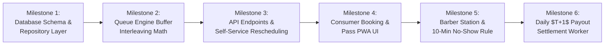

# Implementation Plan & Execution Prompt: Hybrid Appointment Booking Engine

## Overview
This implementation plan and execution prompt enables the full implementation of the **Hybrid Appointment Booking, Dynamic Buffer Interleaving, and Automated Escrow Settlement Engine**.

---

## 1. Subsystem Architecture & Implementation Roadmap



### Milestone 1: Database Migration & Repository
- Create `appointments` table and `salon_payout_records` table in `apps/api/src/db/schema.sql`.
- Add repository methods in `apps/api/src/db/repository.ts`:
  - `createAppointment(appt)`
  - `getAppointmentById(id)`
  - `getAppointmentsBySalonAndDate(salonId, date)`
  - `updateAppointmentStatus(id, status, metadata)`
  - `rescheduleAppointment(id, newDate, newSlotTime, newStylistId)`
  - `createPayoutRecord(payout)`
  - `getSalonPayoutRecords(salonId)`

### Milestone 2: Queue Engine Buffer Interleaving
- Update `apps/api/src/engine/wait-time.ts`:
  - Inject confirmed appointment blocks as immovable time anchors on stylist timelines.
  - Dynamically recalculate walk-in ticket wait times wrapping around appointment buffers.
- Update `apps/api/src/engine/queue-engine.ts`:
  - Enforce 10-minute grace period before auto-releasing seat to top walk-in ticket.

### Milestone 3: API & Webhooks
- `apps/api/src/routes/appointments.ts`:
  - `GET /api/v1/salons/:slug/appointments/slots`
  - `POST /api/v1/appointments/initiate`
  - `POST /api/v1/appointments/confirm`
  - `POST /api/v1/appointments/:id/reschedule` (1-hr cutoff check)
  - `POST /api/v1/appointments/:id/cancel`
  - `POST /api/v1/appointments/:id/check-in`

### Milestone 4: Next.js Frontend Portals
- **Consumer Booking Page:** `apps/web/app/s/[slug]/book/page.tsx`
  - Stylist selector, calendar date picker, time slot grid, and UPI/Razorpay payment trigger.
- **Consumer Reschedule Page:** `apps/web/app/s/[slug]/appointment/[id]/page.tsx`
  - Live booking pass with QR code, 1-tap reschedule modal, and cancel button.
- **Barber Station View:** `apps/web/app/owner/station/page.tsx`
  - Unified timeline showing Walk-ins and Appointments with clear badge indicators (`APPOINTMENT` vs `WALK-IN`).

### Milestone 5: Daily $T+1$ Settlement Worker & Admin Hub
- **Worker:** `apps/api/src/worker/payout-worker.ts`
  - Scheduled for `00:05 AM` daily to calculate $97\%$ net owner payouts (deducting 2% gateway + 1% platform fee).
- **Admin Payouts Hub:** `apps/web/app/admin/payments/payouts/page.tsx`
  - Platform-wide escrow tracker, gross revenue metrics, and payout batch release controls.

---

## 2. Turnkey Execution Prompt for AI Implementer

You can copy and run the exact prompt below into your implementation agent:

```markdown
### TASK: Implement the Complete Hybrid Appointment Booking, Dynamic Buffer Interleaving, and Daily Escrow Payout Engine

#### Architectural Guidelines & Ground Rules:
- **Zero Server Waste:** Do NOT run continuous server timer loops. Compute elapsed times and countdowns on the client using anchor timestamps (`scheduled_date`, `slot_start_time`).
- **Zero Monolithic Pages:** Extract all recurring UI patterns (SlotSelector, BookingPassCard, RescheduleModal, PayoutSummaryCard) into `apps/web/components/`.
- **Mobile-First Touch Targets:** All interactive slot pills and buttons must be >= 48px for thumb interaction on Android.
- **Reference Docs:**
  - PRD: `docs/prd/08_hybrid_appointment_booking_prd.md`
  - TRD: `docs/trd/08_hybrid_appointment_booking_trd.md`
  - Architecture: `docs/architecture/hybrid-appointment-and-queue-engine-architecture.md`
  - ADR: `docs/adr/004-hybrid-appointment-and-escrow-payout.md`

#### Execution Steps:
1. **Database Schema:**
   - Add `appointments` and `salon_payout_records` tables to `apps/api/src/db/schema.sql` per the TRD.
   - Implement corresponding data access methods in `apps/api/src/db/repository.ts`.
2. **Buffer Interleaving Math:**
   - Update `apps/api/src/engine/wait-time.ts` to merge confirmed appointment slots into each stylist's timeline, adjusting walk-in ticket wait times so walk-ins never experience unexpected line cuts.
   - Enforce 10-minute grace window: if customer does not check in by (slot_start_time + 10 mins), auto-summon next walk-in ticket.
3. **API & Reschedule Logic:**
   - Mount `/api/v1/appointments` in `apps/api/src/index.ts`.
   - Implement slot querying, instant booking initiation, Razorpay/UPI confirmation, and self-service rescheduling (validated with a 1-hour cutoff check).
4. **Consumer Web Pages:**
   - Create `apps/web/app/s/[slug]/book/page.tsx` with date picker and slot grid.
   - Create `apps/web/app/s/[slug]/appointment/[id]/page.tsx` with live QR pass and self-service rescheduling.
5. **Barber Station & Owner Settlement:**
   - Enhance `apps/web/app/owner/station/page.tsx` to display appointments alongside walk-ins.
   - Create daily midnight settlement worker in `apps/api/src/worker/payout-worker.ts` calculating 97% net payout (2% PG fee + 1% platform commission).
   - Create `apps/web/app/owner/payouts/page.tsx` and `apps/web/app/admin/payments/payouts/page.tsx` to view daily passbooks and payout statuses.
6. **Verification & Tests:**
   - Add unit tests in `apps/api/test/appointment-engine.test.ts` verifying slot overlap prevention, rescheduling validation, and 97% payout math.
   - Ensure `bun test` passes with zero regressions.
```
