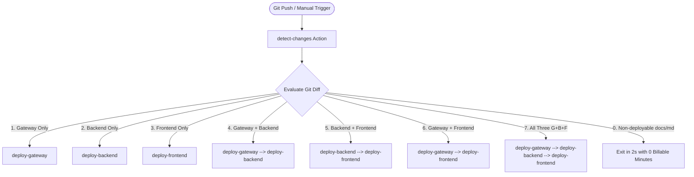

# Master Architecture Plan: Modular, Universal & Resource-Optimized CI/CD Grid

> **For agentic workers:** REQUIRED SUB-SKILL: Use superpowers:subagent-driven-development (recommended) or superpowers:executing-plans to implement this plan task-by-task. Steps use checkbox (`- [ ]`) syntax for tracking.

**Goal:** Build a modular, universal, and compute-optimized GitHub Actions CI/CD deployment engine that supports single or combination deployments across Gateway, Backend, and Frontend. Integrates zero-data-loss database migrations (`bun run db:migrate`), safe in-place Nginx symlinks, server-node decoupling, and robust rollback gates.

**Core Pillars:**
1. **Modularized:** No monolithic scripts; clean, isolated Composite Actions (`.github/actions/*`) orchestrated by a lean workflow (`deploy.yml`).
2. **Resource & Time Optimized:** Single-runner execution eliminates duplicate VM spin-ups (saves 60–70% of billable minutes) and prevents VPS `.git/index.lock` collisions.
3. **Universal ("Anywhere, Anytime"):** Works seamlessly on local Windows (no Nginx needed) and any fresh or existing Linux VPS (AWS EC2, Ubuntu) without configuration drift or git overwrite risks.

---

## 1. Architectural Blueprint & File Layout

```
queue-engine-for-salon/
├── .github/
│   ├── workflows/
│   │   └── deploy.yml                        # Lean Orchestrator (<60 lines)
│   └── actions/
│       ├── detect-changes/                   # Module 1: 7-Combination Matrix Change Detector
│       │   └── action.yml
│       ├── deploy-gateway/                   # Module 2: In-place symlinks, syntax test, rollback
│       │   └── action.yml
│       ├── deploy-backend/                   # Module 3: DB migrations, rolling PM2 reload (:3001, :3002)
│       │   └── action.yml
│       └── deploy-frontend/                  # Module 4: Turbopack compile, zero-downtime PM2 reload (:3000)
│           └── action.yml
├── gateway/
│   ├── salon-frontend-gateway.conf           # Port 80 reverse proxy (REST, WS, Next.js)
│   ├── salon-backend-gateway.conf            # Port 8000 reverse proxy (least_conn load balancer)
│   └── conf.d/
│       └── salon-backend-nodes.inc.example  # Starter template for server-local upstream nodes
└── docs/
    └── superpowers/plans/
        └── 2026-11-20-modular-cicd-pipeline.md # This Master Plan
```

---

## 2. The Complete 7-Combination Execution Matrix



| State # | Combination | Actions Executed in Pipeline | Untouched Modules (Skipped) | Est. VPS Time | Billable Minutes |
| :--- | :--- | :--- | :--- | :--- | :--- |
| **0** | Non-deployable (Docs, `.md`) | None (Early Exit) | All | ~2s | **0 min** |
| **1** | **Gateway Only** | `deploy-gateway` | Backend tests/reload, Next.js build | ~15s | **1 min** |
| **2** | **Backend Only** | `deploy-backend` | Gateway reload, Next.js build | ~25s | **1 min** |
| **3** | **Frontend Only** | `deploy-frontend` | Gateway reload, Backend tests/reload | ~35s | **1 min** |
| **4** | **Gateway + Backend** | `deploy-gateway` $\rightarrow$ `deploy-backend` | Next.js build | ~35s | **1 min** |
| **5** | **Backend + Frontend** | `deploy-backend` $\rightarrow$ `deploy-frontend` | Gateway reload | ~45s | **1 min** |
| **6** | **Gateway + Frontend** | `deploy-gateway` $\rightarrow$ `deploy-frontend` | Backend tests/reload | ~40s | **1 min** |
| **7** | **All Three (G + B + F)** | `deploy-gateway` $\rightarrow$ `deploy-backend` $\rightarrow$ `deploy-frontend` | None | ~65s | **1–2 min** |

---

## 3. Deep-Dive Module Specifications

### Module 1: `detect-changes` (`.github/actions/detect-changes/action.yml`)
- **Responsibility:** Evaluates git diff against `HEAD~1` (or honors manual `workflow_dispatch` dropdown inputs).
- **Paths Monitored:**
  - `gateway/**`, `.github/actions/deploy-gateway/**` $\rightarrow$ sets `run_gateway=true`
  - `apps/api/**`, `ecosystem.config.cjs`, `package.json`, `bun.lock*`, `.github/actions/deploy-backend/**` $\rightarrow$ sets `run_backend=true`
  - `apps/web/**`, `ecosystem.config.cjs`, `package.json`, `bun.lock*`, `.github/actions/deploy-frontend/**` $\rightarrow$ sets `run_frontend=true`
  - `.github/workflows/deploy.yml`, `.github/actions/detect-changes/**` $\rightarrow$ sets all (`run_gateway`, `run_backend`, `run_frontend`) to `true`
- **Output Flags:** `run_gateway`, `run_backend`, `run_frontend`, `run_any`.

### Module 2: `deploy-gateway` (`.github/actions/deploy-gateway/action.yml`)
- **Universal & Drift-Proof:**
  - `salon-backend-gateway.conf` contains `include /etc/nginx/conf.d/salon-backend-nodes.inc;`.
  - Server-specific load balancer nodes live in `/etc/nginx/conf.d/` outside git, so git pushes **never delete or overwrite server-level scaling additions**.
- **Symlink Operation:**
  - Production uses symlinks: `/etc/nginx/sites-enabled/*.conf` $\rightarrow$ `~/queue-engine-for-salon/gateway/*.conf`.
  - Zero copy-pasting. `git pull` updates files in-place instantly.
- **Safety Rollback Gate:**
  - Executes `sudo nginx -t`.
  - If PASS: `sudo systemctl reload nginx` (zero downtime).
  - If FAIL: Runs `git checkout HEAD~1 -- gateway/`, emits error log, and exits 1. Production traffic remains completely unaffected.

### Module 3: `deploy-backend` (`.github/actions/deploy-backend/action.yml`)
- **Runner Quality Gate:** Runs `bun test apps/api/test --parallel=1 --bail` directly on the GitHub runner before touching the production server.
- **Automated Database Migrations (Zero Data Loss):**
  - Runs `bun run db:status` to inspect pending migrations (including Migration 008 `008_queue_tickets_coupons`).
  - Runs `bun run db:migrate` to safely apply new tables/columns.
  - **Pre-restart Failure Protection:** If migration fails, deployment **aborts immediately** before reloading PM2. Live workers remain running on the old code and intact schema.
- **Rolling Zero-Downtime Worker Reload:**
  - Reloads `salon-api-1` (:3001) $\rightarrow$ verifies `http://127.0.0.1:3001/api/health`.
  - Reloads `salon-api-2` (:3002) $\rightarrow$ verifies `http://127.0.0.1:3002/api/health`.
  - Graceful fallback: If worker was stopped or new, starts via `ecosystem.config.cjs`.
  - Saves cluster state: `pm2 save`.

### Module 4: `deploy-frontend` (`.github/actions/deploy-frontend/action.yml`)
- **Compilation:** Executes Turbopack build `bun run build:frontend` on VPS (takes ~1.9s to 5s).
- **Zero-Downtime Reload:** `pm2 reload salon-frontend --update-env`.
- **Health Verification:** Verifies `curl -fsS http://127.0.0.1:3000` returns 200 OK.
- Saves cluster state: `pm2 save`.

### The Orchestrator: `deploy.yml` (`.github/workflows/deploy.yml`)
- **Single Runner Session:** Runs on `ubuntu-latest`.
- **Timeout Protection:** `timeout-minutes: 10` prevents runaway processes from draining quotas.
- **Concurrency Locking:** `concurrency: group: production-deploy, cancel-in-progress: false` serializes incoming commits and prevents server `.git/index.lock` collisions.
- **Single Coordinated Pull:** Runs exactly ONE `git pull origin main` in `~/queue-engine-for-salon` when `run_any == 'true'`.
- **Sequential Execution:** Executes modules in strict topological order ($Gateway \to Backend \to Frontend$).

---

## 4. Universal VPS One-Time Setup (Anywhere, Anytime)

On any fresh or existing Ubuntu VPS, running these three commands establishes the environment permanently:

```bash
# 1. Create server-local nodes file (outside git)
sudo mkdir -p /etc/nginx/conf.d
sudo cp ~/queue-engine-for-salon/gateway/conf.d/salon-backend-nodes.inc.example /etc/nginx/conf.d/salon-backend-nodes.inc

# 2. Establish direct symlinks
sudo ln -sf ~/queue-engine-for-salon/gateway/salon-frontend-gateway.conf /etc/nginx/sites-enabled/salon-frontend.conf
sudo ln -sf ~/queue-engine-for-salon/gateway/salon-backend-gateway.conf /etc/nginx/sites-enabled/salon-backend.conf

# 3. Verify and reload
sudo nginx -t && sudo systemctl reload nginx
```

---

## 5. Implementation Tasks (Bite-Sized)

- [x] **Task 1: Gateway Decoupling & Node Isolation**
  - Update `gateway/salon-backend-gateway.conf` to include `/etc/nginx/conf.d/salon-backend-nodes.inc;`
  - Create template `gateway/conf.d/salon-backend-nodes.inc.example`
- [x] **Task 2: Build `detect-changes` Composite Action**
  - Implement 7-combination detection matrix in `.github/actions/detect-changes/action.yml`
- [x] **Task 3: Build `deploy-gateway` Composite Action**
  - Implement syntax testing, in-place reload, and git rollback in `.github/actions/deploy-gateway/action.yml`
- [x] **Task 4: Build `deploy-backend` Composite Action**
  - Implement runner unit tests, VPS `bun run db:migrate`, rolling PM2 restart, and health verify in `.github/actions/deploy-backend/action.yml`
- [x] **Task 5: Build `deploy-frontend` Composite Action**
  - Implement Turbopack build, PM2 reload, and port 3000 verification in `.github/actions/deploy-frontend/action.yml`
- [x] **Task 6: Implement Orchestrator Workflow**
  - Refactor `.github/workflows/deploy.yml` with single-runner coordination, strict timeouts, and concurrency controls
- [x] **Task 7: Local Syntax Verification & Git Push**
  - Validate YAML formatting, commit to `main`, and push to remote.
