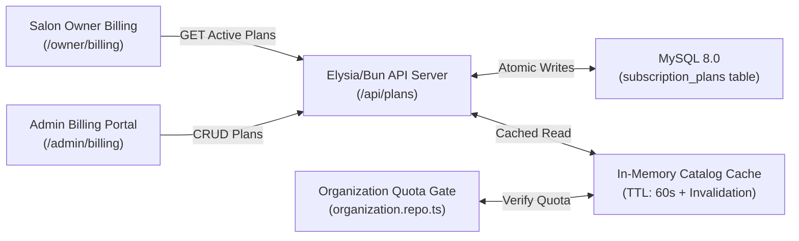

# Technical Requirements Document (TRD): Dynamic Subscription Plans & Feature Quota Engine

## 1. Technical Architecture & Component Hierarchy

The Dynamic Subscription Plans Engine bridges the SuperAdmin dashboard, the backend persistence layer, and the tenant billing portal via lightweight, headless contracts.



---

## 2. Database Schema (`subscription_plans`)

Added to `apps/api/src/db/mysql.ts` in the `safeTables` migration array:

```sql
CREATE TABLE IF NOT EXISTS subscription_plans (
    id VARCHAR(36) PRIMARY KEY,
    name VARCHAR(100) NOT NULL,
    slug VARCHAR(100) NOT NULL UNIQUE,
    badge VARCHAR(50) NULL,
    description TEXT NULL,
    price_1m DECIMAL(10,2) NOT NULL,
    price_3m DECIMAL(10,2) NULL,
    price_6m DECIMAL(10,2) NULL,
    price_1y DECIMAL(10,2) NULL,
    discount_pct_3m DECIMAL(5,2) DEFAULT 10.00,
    discount_pct_6m DECIMAL(5,2) DEFAULT 16.00,
    discount_pct_1y DECIMAL(5,2) DEFAULT 30.00,
    cycle_1m_enabled BOOLEAN DEFAULT TRUE,
    cycle_3m_enabled BOOLEAN DEFAULT TRUE,
    cycle_6m_enabled BOOLEAN DEFAULT TRUE,
    cycle_1y_enabled BOOLEAN DEFAULT TRUE,
    max_branches INT NOT NULL DEFAULT 1,
    max_stylists_per_branch INT NOT NULL DEFAULT 2,
    features JSON NOT NULL,
    status ENUM('ACTIVE', 'DRAFT', 'ARCHIVED') DEFAULT 'ACTIVE',
    is_featured BOOLEAN DEFAULT FALSE,
    sort_order INT DEFAULT 0,
    created_at TIMESTAMP DEFAULT CURRENT_TIMESTAMP,
    updated_at TIMESTAMP DEFAULT CURRENT_TIMESTAMP ON UPDATE CURRENT_TIMESTAMP,
    INDEX idx_plan_status (status, sort_order)
) ENGINE=InnoDB;
```

---

## 3. TypeScript Interfaces (`apps/api/src/engine/types.ts` & `apps/web/lib/api.ts`)

```typescript
export type BillingCycle = '1m' | '3m' | '6m' | '1y';

export type PlanStatus = 'ACTIVE' | 'DRAFT' | 'ARCHIVED';

export interface SubscriptionPlan {
  id: string;
  name: string;
  slug: string;
  badge?: string | null;
  description?: string | null;
  price1m: number;
  price3m?: number | null;
  price6m?: number | null;
  price1y?: number | null;
  discountPct3m: number;
  discountPct6m: number;
  discountPct1y: number;
  cycle1mEnabled: boolean;
  cycle3mEnabled: boolean;
  cycle6mEnabled: boolean;
  cycle1yEnabled: boolean;
  maxBranches: number;
  maxStylistsPerBranch: number;
  features: string[];
  status: PlanStatus;
  isFeatured: boolean;
  sortOrder: number;
  createdAt: string;
  updatedAt: string;
}

export interface CreatePlanPayload {
  name: string;
  slug?: string;
  badge?: string;
  description?: string;
  price1m: number;
  price3m?: number;
  price6m?: number;
  price1y?: number;
  discountPct3m?: number;
  discountPct6m?: number;
  discountPct1y?: number;
  cycle1mEnabled?: boolean;
  cycle3mEnabled?: boolean;
  cycle6mEnabled?: boolean;
  cycle1yEnabled?: boolean;
  maxBranches: number;
  maxStylistsPerBranch: number;
  features: string[];
  status?: PlanStatus;
  isFeatured?: boolean;
  sortOrder?: number;
}
```

---

## 4. Headless REST API Specification (`apps/api/src/routes/plan.routes.ts`)

### `GET /api/plans`
- **Access:** Public / Authenticated Tenants.
- **Query Params:** `status` (defaults to `ACTIVE` for tenant portal, allows `all` for SuperAdmin).
- **Response:**
  ```json
  {
    "success": true,
    "plans": [
      {
        "id": "plan-solo-01",
        "name": "Solo Barber",
        "slug": "solo-barber",
        "badge": "Popular",
        "price1m": 499,
        "price3m": 1349,
        "discountPct3m": 10.0,
        "cycle1mEnabled": true,
        "cycle3mEnabled": true,
        "cycle6mEnabled": false,
        "cycle1yEnabled": true,
        "maxBranches": 1,
        "maxStylistsPerBranch": 1,
        "features": ["station_chair_transfers", "tv_departure_mirror"],
        "status": "ACTIVE"
      }
    ]
  }
  ```

### `POST /api/plans`
- **Access:** SuperAdmin only.
- **Body:** `CreatePlanPayload`.
- **Response:** `{ "success": true, "plan": SubscriptionPlan }`.
- **Side Effect:** Invalidates in-memory plan cache.

### `PATCH /api/plans/:id`
- **Access:** SuperAdmin only.
- **Body:** Partial updates to prices, quotas, features, or cycles.
- **Response:** `{ "success": true, "plan": SubscriptionPlan }`.

### `DELETE /api/plans/:id`
- **Access:** SuperAdmin only.
- **Behavior:** Soft-archives plan (`status = 'ARCHIVED'`) so historical tenant subscriptions remain valid.

---

## 5. Dynamic Quota Gate Integration (`organization.repo.ts`)

Instead of hardcoded switch blocks:
```typescript
// Legacy hardcoded logic:
const limits = {
  STARTER: { maxBranches: 1, maxStylists: 1 },
  PRO: { maxBranches: 3, maxStylists: 5 },
  ENTERPRISE: { maxBranches: 10, maxStylists: 20 },
};
```
The quota gate dynamically queries the tenant's subscribed plan:
```typescript
const plan = await planRepo.getPlanById(org.planId || org.tier);
const maxBranches = plan?.maxBranches ?? org.maxBranches ?? 1;
const maxStylists = plan?.maxStylistsPerBranch ?? org.maxStylistsPerBranch ?? 2;
```
This guarantees that whenever an Admin changes plan limits, tenant gates immediately adapt without restarting the backend!
