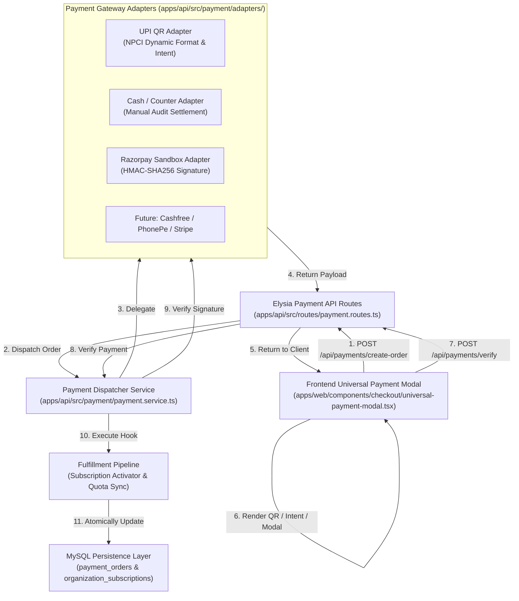

# Technical Requirements Document (TRD): Universal Pluggable Payment Gateway Engine

## 1. Architectural Architecture & Strategy Pattern

The Universal Payment Gateway Engine abstracts all monetary transactions behind an extensible Strategy / Adapter interface.



---

## 2. Database Schema Definitions

### 2.1 `payment_orders` Table
```sql
CREATE TABLE IF NOT EXISTS payment_orders (
    id VARCHAR(36) PRIMARY KEY,
    target_type ENUM('SUBSCRIPTION', 'QUEUE_TICKET', 'WALLET_TOPUP') NOT NULL,
    target_id VARCHAR(36) NOT NULL,
    organization_id VARCHAR(36) NULL,
    salon_id VARCHAR(36) NULL,
    customer_id VARCHAR(36) NULL,
    amount DECIMAL(10,2) NOT NULL,
    currency VARCHAR(10) DEFAULT 'INR',
    provider ENUM('UPI_QR', 'CASH', 'RAZORPAY') NOT NULL,
    provider_order_id VARCHAR(100) NULL,
    transaction_ref VARCHAR(100) NULL,
    status ENUM('PENDING', 'COMPLETED', 'FAILED', 'EXPIRED', 'REFUNDED') DEFAULT 'PENDING',
    payment_data JSON NULL,
    metadata JSON NULL,
    expires_at TIMESTAMP NOT NULL,
    completed_at TIMESTAMP NULL,
    created_at TIMESTAMP DEFAULT CURRENT_TIMESTAMP,
    updated_at TIMESTAMP DEFAULT CURRENT_TIMESTAMP ON UPDATE CURRENT_TIMESTAMP,
    INDEX idx_order_status (status, target_type),
    INDEX idx_order_org (organization_id, created_at),
    INDEX idx_order_salon (salon_id, created_at)
) ENGINE=InnoDB;
```

### 2.2 `organization_subscriptions` Table
```sql
CREATE TABLE IF NOT EXISTS organization_subscriptions (
    id VARCHAR(36) PRIMARY KEY,
    organization_id VARCHAR(36) NOT NULL,
    plan_id VARCHAR(36) NOT NULL,
    cycle ENUM('1m', '3m', '6m', '1y', 'custom') NOT NULL,
    starts_at TIMESTAMP NOT NULL,
    expires_at TIMESTAMP NOT NULL,
    base_price DECIMAL(10,2) NOT NULL,
    coupon_id VARCHAR(36) NULL,
    coupon_discount DECIMAL(10,2) DEFAULT 0.00,
    wallet_deducted DECIMAL(10,2) DEFAULT 0.00,
    net_amount_paid DECIMAL(10,2) NOT NULL,
    payment_method VARCHAR(50) NOT NULL,
    payment_order_id VARCHAR(36) NULL,
    transaction_ref VARCHAR(100) NULL,
    status ENUM('ACTIVE', 'EXPIRED', 'CANCELLED', 'GRACE_PERIOD') DEFAULT 'ACTIVE',
    created_at TIMESTAMP DEFAULT CURRENT_TIMESTAMP,
    updated_at TIMESTAMP DEFAULT CURRENT_TIMESTAMP ON UPDATE CURRENT_TIMESTAMP,
    INDEX idx_org_sub (organization_id, status)
) ENGINE=InnoDB;
```

---

## 3. Core TypeScript Contracts & Interfaces

File: `apps/api/src/payment/types.ts`
```ts
export type PaymentProvider = 'UPI_QR' | 'CASH' | 'RAZORPAY';
export type PaymentTargetType = 'SUBSCRIPTION' | 'QUEUE_TICKET' | 'WALLET_TOPUP';
export type PaymentOrderStatus = 'PENDING' | 'COMPLETED' | 'FAILED' | 'EXPIRED' | 'REFUNDED';

export interface PaymentOrderPayload {
  targetType: PaymentTargetType;
  targetId: string;
  organizationId?: string | null;
  salonId?: string | null;
  customerId?: string | null;
  amount: number;
  currency?: string;
  metadata?: Record<string, any>;
}

export interface PaymentOrderResult {
  orderId: string;
  provider: PaymentProvider;
  amount: number;
  currency: string;
  expiresAt: string;
  // Specific data needed by client to render or process payment
  paymentData: {
    upiString?: string;
    upiIntentUrl?: string;
    razorpayOrderId?: string;
    razorpayKeyId?: string;
    cashInstructions?: string;
    [key: string]: any;
  };
}

export interface PaymentVerificationPayload {
  orderId: string;
  provider: PaymentProvider;
  transactionRef?: string;
  razorpayPaymentId?: string;
  razorpaySignature?: string;
  notes?: string;
}

export interface PaymentVerificationResult {
  success: boolean;
  orderId: string;
  status: PaymentOrderStatus;
  transactionRef: string;
  message?: string;
  subscription?: any;
}

export interface PaymentGatewayAdapter {
  getProviderName(): PaymentProvider;
  createOrder(payload: PaymentOrderPayload, internalOrderId: string): Promise<PaymentOrderResult['paymentData']>;
  verifyPayment(order: any, payload: PaymentVerificationPayload): Promise<{ verified: boolean; transactionRef: string; message?: string }>;
}
```

---

## 4. Concrete Adapters Implementation

### 4.1 NPCI UPI QR Adapter (`apps/api/src/payment/adapters/upi-qr.adapter.ts`)
- Builds standard NPCI UPI URI:
  ```
  upi://pay?pa={vpa}&pn={payeeName}&am={amount}&cu=INR&tr={orderId}&tn={notes}
  ```
- Client renders URI directly as QR code on `<canvas>` or inline SVG (Zero server waste).
- On mobile devices, intent launcher opens installed apps (Google Pay, PhonePe, Paytm, BHIM).
- Verification validates presence of transaction reference (UTR) or operator confirmation.

### 4.2 Cash / Counter Adapter (`apps/api/src/payment/adapters/cash.adapter.ts`)
- For offline counter collections.
- Generates receipt reference `CASH-{TIMESTAMP}-{RANDOM}`.
- Verification checks authorization and marks order settled.

### 4.3 Razorpay Sandbox Adapter (`apps/api/src/payment/adapters/razorpay.adapter.ts`)
- Pre-configured with dummy test keys (`rzp_test_51...` and secret `dummy_secret_test`).
- Simulates standard order creation and signature verification:
  $$\text{Expected Signature} = \text{HMAC-SHA256}(\text{order\_id} + "|" + \text{payment\_id}, \text{secret})$$
- In sandbox mode, accepts valid test signatures or simulated test verification.

---

## 5. Fulfillment & Subscription Activation Hook
When `payment.service.ts` successfully verifies an order with `target_type === 'SUBSCRIPTION'`:
1. Looks up the plan details (`planRepo.getPlanById(order.target_id)`).
2. Calculates expiration date based on the chosen cycle:
   - `1m`: 30 days
   - `3m`: 90 days
   - `6m`: 180 days
   - `1y`: 365 days
   *(If organization already has an active subscription expiring in the future, the new duration is appended to the existing `expires_at` date).*
3. Updates `organizations` table: sets `plan_id = plan.id`, `max_branches = plan.maxBranches`, `max_stylists_per_branch = plan.maxStylistsPerBranch`.
4. Inserts row into `organization_subscriptions`.
5. Invalidates in-memory catalog and organization caches.

---

## 6. Elysia REST Endpoints

- `POST /api/payments/create-order`
  - Body: `{ targetType, targetId, provider, amount, organizationId?, salonId?, metadata? }`
  - Returns: `{ success: true, order: PaymentOrderResult }`
- `POST /api/payments/verify`
  - Body: `{ orderId, provider, transactionRef?, razorpayPaymentId?, razorpaySignature?, notes? }`
  - Returns: `{ success: true, result: PaymentVerificationResult }`
- `GET /api/payments/:id`
  - Returns: `{ success: true, order: PaymentOrder }`
- `GET /api/salons/organizations/:id/subscription`
  - Returns current active subscription record, expiration date, and days remaining.
