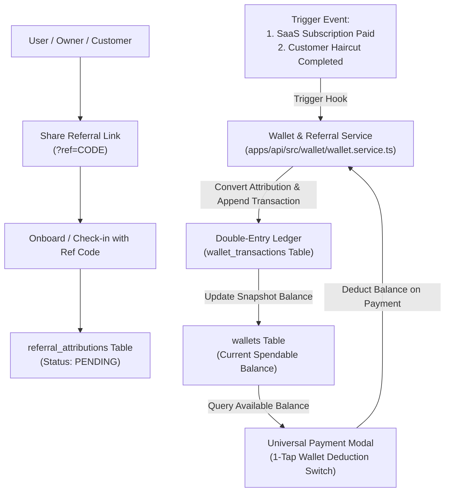

# Technical Requirements Document (TRD): Dual-Wallet & Referral Commission Engine

## 1. Technical Architecture & Component Flow



---

## 2. Database Schema

### 2.1 `wallets` Table
```sql
CREATE TABLE IF NOT EXISTS wallets (
    id VARCHAR(36) PRIMARY KEY,
    wallet_type ENUM('OWNER', 'CONSUMER') NOT NULL,
    owner_org_id VARCHAR(36) NULL,
    consumer_phone VARCHAR(20) NULL,
    salon_id VARCHAR(36) NULL,
    balance DECIMAL(10,2) NOT NULL DEFAULT 0.00,
    currency VARCHAR(10) DEFAULT 'INR',
    created_at TIMESTAMP DEFAULT CURRENT_TIMESTAMP,
    updated_at TIMESTAMP DEFAULT CURRENT_TIMESTAMP ON UPDATE CURRENT_TIMESTAMP,
    UNIQUE KEY uq_owner_wallet (owner_org_id),
    UNIQUE KEY uq_consumer_wallet (salon_id, consumer_phone),
    INDEX idx_wallet_type (wallet_type)
) ENGINE=InnoDB;
```

### 2.2 `wallet_transactions` Table
```sql
CREATE TABLE IF NOT EXISTS wallet_transactions (
    id VARCHAR(36) PRIMARY KEY,
    wallet_id VARCHAR(36) NOT NULL,
    wallet_type ENUM('OWNER', 'CONSUMER') NOT NULL,
    owner_org_id VARCHAR(36) NULL,
    consumer_phone VARCHAR(20) NULL,
    salon_id VARCHAR(36) NULL,
    type ENUM('CREDIT', 'DEBIT') NOT NULL,
    amount DECIMAL(10,2) NOT NULL,
    balance_after DECIMAL(10,2) NOT NULL,
    reason VARCHAR(255) NOT NULL,
    reference_id VARCHAR(100) NULL,
    created_at TIMESTAMP DEFAULT CURRENT_TIMESTAMP,
    INDEX idx_trans_wallet (wallet_id, created_at),
    INDEX idx_trans_owner (owner_org_id, created_at),
    INDEX idx_trans_consumer (salon_id, consumer_phone, created_at)
) ENGINE=InnoDB;
```

### 2.3 `referral_attributions` Table
```sql
CREATE TABLE IF NOT EXISTS referral_attributions (
    id VARCHAR(36) PRIMARY KEY,
    referral_type ENUM('B2B_OWNER', 'B2C_CONSUMER') NOT NULL,
    referrer_code VARCHAR(50) NOT NULL,
    referrer_org_id VARCHAR(36) NULL,
    referrer_phone VARCHAR(20) NULL,
    referred_org_id VARCHAR(36) NULL,
    referred_phone VARCHAR(20) NULL,
    salon_id VARCHAR(36) NULL,
    reward_amount DECIMAL(10,2) NOT NULL,
    status ENUM('PENDING', 'CONVERTED', 'EXPIRED') DEFAULT 'PENDING',
    conversion_reference_id VARCHAR(100) NULL,
    converted_at TIMESTAMP NULL,
    created_at TIMESTAMP DEFAULT CURRENT_TIMESTAMP,
    updated_at TIMESTAMP DEFAULT CURRENT_TIMESTAMP ON UPDATE CURRENT_TIMESTAMP,
    INDEX idx_ref_code (referrer_code),
    INDEX idx_ref_org (referrer_org_id, status),
    INDEX idx_referred_org (referred_org_id)
) ENGINE=InnoDB;
```

---

## 3. Core TypeScript Contracts & Interfaces

File: `apps/api/src/wallet/types.ts`
```ts
export type WalletType = 'OWNER' | 'CONSUMER';
export type WalletTransactionType = 'CREDIT' | 'DEBIT';
export type ReferralType = 'B2B_OWNER' | 'B2C_CONSUMER';
export type ReferralStatus = 'PENDING' | 'CONVERTED' | 'EXPIRED';

export interface Wallet {
  id: string;
  walletType: WalletType;
  ownerOrgId?: string | null;
  consumerPhone?: string | null;
  salonId?: string | null;
  balance: number;
  currency: string;
  createdAt: Date | string;
  updatedAt: Date | string;
}

export interface WalletTransaction {
  id: string;
  walletId: string;
  walletType: WalletType;
  ownerOrgId?: string | null;
  consumerPhone?: string | null;
  salonId?: string | null;
  type: WalletTransactionType;
  amount: number;
  balanceAfter: number;
  reason: string;
  referenceId?: string | null;
  createdAt: Date | string;
}

export interface ReferralAttribution {
  id: string;
  referralType: ReferralType;
  referrerCode: string;
  referrerOrgId?: string | null;
  referrerPhone?: string | null;
  referredOrgId?: string | null;
  referredPhone?: string | null;
  salonId?: string | null;
  rewardAmount: number;
  status: ReferralStatus;
  conversionReferenceId?: string | null;
  convertedAt?: Date | string | null;
  createdAt: Date | string;
  updatedAt: Date | string;
}
```

---

## 4. Atomic Ledger & Concurrency Architecture

### 4.1 Debiting Funds (Anti-Overdraft)
```ts
// Atomic row-level lock on MySQL
SELECT * FROM wallets WHERE id = ? FOR UPDATE;
```
If `wallet.balance < debitAmount`, the transaction rejects immediately with:
`Insufficient wallet balance. Available: ₹{wallet.balance}`.

### 4.2 Checkout Formula
$$\text{Payable} = \max(0, \text{BasePrice} - \text{CouponDiscount} - \text{WalletDeduction})$$
If $\text{Net Payable} = 0$, payment method is `'WALLET'` and skips third-party gateway redirection.

---

## 5. Automated Conversion Hooks

### 5.1 B2B Owner Conversion Hook (Payment Verified)
When `payment.service.ts` verifies a subscription payment:
1. Checks if `order.organizationId` has a `PENDING` referral in `referral_attributions`.
2. Marks attribution `CONVERTED` with `conversion_reference_id = order.id`.
3. Credits ₹500 to `referrer_org_id`'s wallet.
4. Logs transaction in `wallet_transactions` with `balance_after`.

### 5.2 B2C Consumer Conversion Hook (Ticket Completed)
When a queue ticket is marked `COMPLETED`:
1. Checks if `ticket.customerPhone` has a `PENDING` consumer referral.
2. Marks attribution `CONVERTED` with `conversion_reference_id = ticket.id`.
3. Credits ₹50 to `referrer_phone`'s wallet for that `salon_id`.

---

## 6. Elysia REST Endpoints

- `GET /api/wallets/balance`: Returns spendable balance for org or consumer.
- `GET /api/wallets/passbook`: Returns transaction history.
- `GET /api/referrals/stats`: Returns total referred count, earned rewards, and share links.
- `POST /api/referrals/attribute`: Records incoming referral code on signup or visit.
