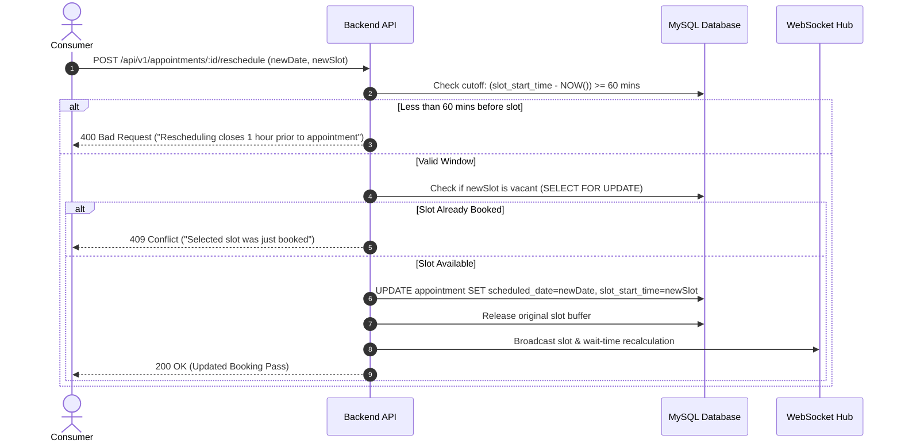

# Technical Requirements Document (TRD): Hybrid Appointment Booking & Queue Engine

## 1. Executive Summary & Architecture Overview
- **Subsystem:** Hybrid Appointment Booking, Dynamic Buffer Interleaving, and Automated Escrow Settlement
- **Runtime:** Bun + Elysia (API backend) with MySQL 8.0 (InnoDB)
- **Frontend:** Next.js 16 App Router (React 19) + PWA Offline Resilience
- **Key Design Objective:** Maintain zero server waste (client-compute live timers) while enforcing atomic slot reservation, instant payment confirmation, transparent walk-in wait times, and seamless customer rescheduling.

---

## 2. Database Schema (MySQL 8.0 DDL)

```sql
-- 1. Advance Appointments Table
CREATE TABLE IF NOT EXISTS appointments (
    id VARCHAR(64) PRIMARY KEY,
    salon_id VARCHAR(64) NOT NULL,
    stylist_id VARCHAR(64) NULL,
    customer_name VARCHAR(100) NOT NULL,
    customer_phone VARCHAR(20) NOT NULL,
    service_id VARCHAR(64) NOT NULL,
    service_name VARCHAR(100) NOT NULL,
    scheduled_date DATE NOT NULL,
    slot_start_time VARCHAR(5) NOT NULL, -- 'HH:mm' 24-hr format (e.g. '11:00')
    slot_end_time VARCHAR(5) NOT NULL,   -- 'HH:mm' 24-hr format (e.g. '11:40')
    duration_minutes INT NOT NULL DEFAULT 30,
    advance_amount DECIMAL(10, 2) NOT NULL DEFAULT 0.00,
    total_price DECIMAL(10, 2) NOT NULL DEFAULT 0.00,
    payment_method ENUM('RAZORPAY', 'UPI_QR', 'WALLET', 'PAY_AT_SALON') NOT NULL DEFAULT 'RAZORPAY',
    gateway_order_id VARCHAR(128) NULL,
    gateway_payment_id VARCHAR(128) NULL,
    escrow_status ENUM('HELD', 'RELEASED_TO_OWNER', 'REFUNDED_TO_CUSTOMER', 'PARTIAL_SPLIT') NOT NULL DEFAULT 'HELD',
    status ENUM('PENDING_PAYMENT', 'CONFIRMED', 'CHECKED_IN', 'IN_CHAIR', 'COMPLETED', 'CANCELLED', 'NO_SHOW', 'RESCHEDULED') NOT NULL DEFAULT 'PENDING_PAYMENT',
    rescheduled_from_id VARCHAR(64) NULL,
    created_at TIMESTAMP DEFAULT CURRENT_TIMESTAMP,
    updated_at TIMESTAMP DEFAULT CURRENT_TIMESTAMP ON UPDATE CURRENT_TIMESTAMP,
    INDEX idx_salon_slot (salon_id, scheduled_date, status),
    INDEX idx_customer (customer_phone),
    INDEX idx_stylist_slot (stylist_id, scheduled_date, slot_start_time),
    FOREIGN KEY (salon_id) REFERENCES salons(id) ON DELETE CASCADE
) ENGINE=InnoDB DEFAULT CHARSET=utf8mb4 COLLATE=utf8mb4_unicode_ci;

-- 2. Daily Salon Payout Ledger Table
CREATE TABLE IF NOT EXISTS salon_payout_records (
    id VARCHAR(64) PRIMARY KEY,
    salon_id VARCHAR(64) NOT NULL,
    period_start DATE NOT NULL,
    period_end DATE NOT NULL,
    gross_amount DECIMAL(10, 2) NOT NULL DEFAULT 0.00,
    gateway_fee DECIMAL(10, 2) NOT NULL DEFAULT 0.00,     -- 2.0%
    platform_fee DECIMAL(10, 2) NOT NULL DEFAULT 0.00,    -- 1.0%
    net_payout DECIMAL(10, 2) NOT NULL DEFAULT 0.00,      -- 97.0%
    payout_vpa VARCHAR(100) NULL,                         -- UPI VPA or Bank Account
    payout_reference_id VARCHAR(128) NULL,
    status ENUM('PENDING', 'PROCESSING', 'SETTLED', 'FAILED') NOT NULL DEFAULT 'PENDING',
    settled_at TIMESTAMP NULL,
    created_at TIMESTAMP DEFAULT CURRENT_TIMESTAMP,
    INDEX idx_salon_payout (salon_id, status, created_at),
    FOREIGN KEY (salon_id) REFERENCES salons(id) ON DELETE CASCADE
) ENGINE=InnoDB DEFAULT CHARSET=utf8mb4 COLLATE=utf8mb4_unicode_ci;
```

---

## 3. Dynamic Buffer & Interleaving Algorithm

The core innovation is that scheduled appointments are treated as **Fixed Time Anchors**, while walk-ins form an **Elastic Queue** that smoothly flows into available chair gaps.

```mermaid
gantt
    title Stylist Timeline: Interleaved Walk-ins & Locked Appointments
    dateFormat  HH:mm
    axisFormat  %H:%M
    section Chair 1
    Current Walk-in (In Chair)     :done,    des1, 10:15, 10:45
    Quick Walk-in Gap (15 mins)    :active,  des2, 10:45, 11:00
    Prepaid Appointment (Rohan)     :crit,    des3, 11:00, 11:40
    Long Walk-in Ticket #104       :         des4, 11:40, 12:20
```



### Algorithm Steps (`apps/api/src/engine/wait-time.ts`):
1. **Query Active State:** Fetch all active `IN_CHAIR` and `WAITING` tickets, plus all `CONFIRMED` appointments for `today`.
2. **Build Chair Timeline:** For each active stylist:
   - Identify when current `IN_CHAIR` finishes: $T_{\text{chair\_free}}$.
   - Place confirmed appointment blocks $[S_{\text{start}}, S_{\text{end}}]$ onto the timeline.
3. **Queue Insertion Logic:**
   - Iterate through pending walk-in tickets in FIFO order.
   - If $T_{\text{chair\_free}} + \text{service\_duration} \le S_{\text{start}}$, seat walk-in ticket before the appointment.
   - If not enough time before $S_{\text{start}}$, the walk-in ticket's start time is shifted to $\max(T_{\text{chair\_free}}, S_{\text{end}})$.
   - Store calculated `estimatedWaitMinutes = (calculated_start_time - now)` on the ticket.
4. **WebSocket Broadcast:** Push updated wait times to consumer phones, lobby TV, and barber station.

---

## 4. Self-Service Rescheduling Engine

Consumers can reschedule an appointment up to **1 hour** prior to the slot with zero penalty.

### Atomic Reschedule Flow:


---

## 5. API Contracts & Endpoint Specifications

### 5.1 Slots & Calendar
- `GET /api/v1/salons/:slug/appointments/slots?date=YYYY-MM-DD&stylistId=optional`
  - **Response:**
    ```json
    {
      "date": "2026-11-10",
      "slots": [
        { "time": "10:00", "available": true, "stylistId": "sty_1" },
        { "time": "10:30", "available": false, "reason": "APPOINTMENT_BOOKED" },
        { "time": "11:00", "available": true, "stylistId": "sty_2" }
      ]
    }
    ```

### 5.2 Initiate & Confirm Prepaid Booking
- `POST /api/v1/appointments/initiate`
  - **Payload:** `{ salonSlug, serviceId, addOnIds, stylistId, date, slotTime, customerName, customerPhone, advanceType: 'TOKEN' | 'FULL' }`
  - **Response:** `{ appointmentId, advanceAmount, razorpayOrderId, upiQrString }`
- `POST /api/v1/appointments/confirm`
  - **Payload:** `{ appointmentId, paymentId, signature }`
  - **Behavior:** Verifies gateway signature, marks `CONFIRMED`, triggers WhatsApp booking pass.

### 5.3 Reschedule & Cancellation
- `POST /api/v1/appointments/:id/reschedule`
  - **Payload:** `{ newDate, newSlotTime, newStylistId }`
- `POST /api/v1/appointments/:id/cancel`
  - **Refund Rule:** $>2\text{ hrs} \rightarrow 100\%$ refund; $<2\text{ hrs} \rightarrow 50\%$ refund.

### 5.4 Check-in & Station Actions
- `POST /api/v1/appointments/:id/check-in`
  - Triggered when consumer scans lobby QR or arrives at salon. Marks `CHECKED_IN` and positions ticket at top of chair dispatch queue.
- `POST /api/v1/appointments/:id/no-show`
  - If customer $>10$ mins late, staff clicks 1-tap `No Show`. Forfeits token advance to salon ledger, frees chair immediately.

---

## 6. Daily Settlement ($T+1$) Cron Worker

A background cron runs at `00:05 AM` daily:
1. Aggregates all `COMPLETED` appointments for previous date (`period_end = yesterday`).
2. Calculates:
   - $\text{Gross Amount} = \sum \text{advance\_amount}$
   - $\text{Gateway Fee} = \text{Gross} \times 0.02$
   - $\text{Platform Commission} = \text{Gross} \times 0.01$
   - $\text{Net Payout} = \text{Gross} \times 0.97$
3. Records entry in `salon_payout_records`.
4. Initiates automated bank transfer via Payout Gateway API or queues for Super Admin 1-tap batch release.
